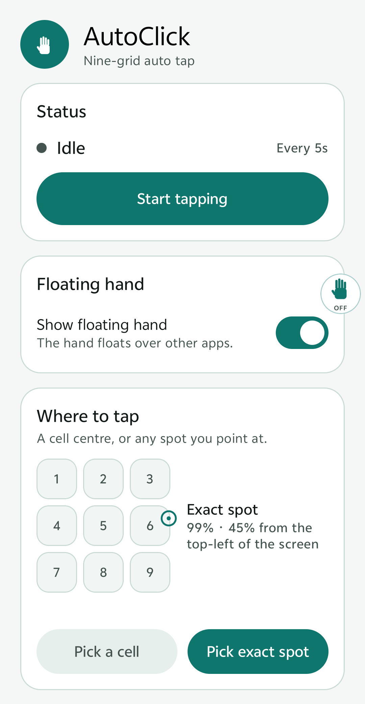
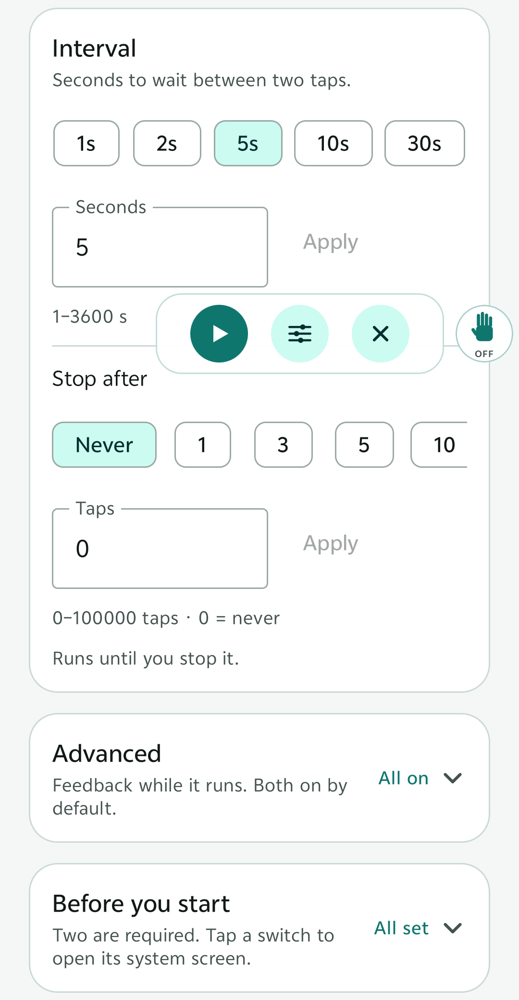

  
  <h1>AutoClick</h1>
  
<strong>Taps one spot on your screen, on a timer you set.</strong>

  
Android 8 or newer · English · Works completely offline · No ads or accounts

---

## What It Does

AutoClick is a quiet, focused auto-tapper built for everyday repetitive taps — counters, claim buttons, keep-alive screens, or simple games — without clutter or tracking.

- **Grid or exact-spot aiming** — Pick any cell on a simple 3×3 screen grid, or point directly at the exact spot you want tapped.
- **Flexible pace** — Set any wait time from **1 second to 1 hour**, using quick presets or your own custom number.
- **Optional tap limit** — Run until you stop it, or automatically finish after a chosen number of taps (up to 100,000).
- **Floating hand controller** — Start, stop, change your target, or adjust the timer from inside any app, with a countdown ring showing when the next tap lands.
- **Thoughtful everyday behaviour** — Pauses automatically when your screen turns off, refuses to tap through its own controls, and optionally gives a gentle buzz or ring flash where each tap lands.
- **Private by design** — No internet access, no screen reading, and nothing ever leaves your phone.

---

## Screenshots

  <table>
    <tr>
      <td align="center">
         
        <b>Target & status</b> Pick a grid cell or an exact spot
      </td>
      <td align="center">
         
        <b>Timing & floating controls</b> Set your pace and control from anywhere
      </td>
    </tr>
  </table>

---

## Floating Hand Gestures

| Gesture | What it does |
|---|---|
| **Tap** | Opens or closes the compact panel to start, stop, change the cell, or adjust seconds. |
| **Drag** | Moves the floating hand anywhere along the left or right edge of your screen. |
| **Long-press** | Shows a quick hide button to put the floating hand away and stop tapping. |
| **Bring it back** | Turn **Show floating hand** back on in the app (or press **Start tapping**). |

---

## How to Install

1. **Download** the latest `.apk` file from the **Releases** page and open it on your phone.
2. **Allow unknown apps** when your phone asks if your browser or file manager can install apps.
3. **Allow restricted settings (Android 13 or newer):** open your phone's **Settings → Apps → AutoClick**, tap the **⋮** menu in the corner, and choose **Allow restricted settings**.
4. **Turn on the two required switches** — **Accessibility ("AutoClick taps")** and **Display over other apps**. AutoClick opens each settings screen for you and guides you straight to its row. The floating hand appears right away as soon as both are on.

---

## License

Released under the [MIT License](LICENSE).
