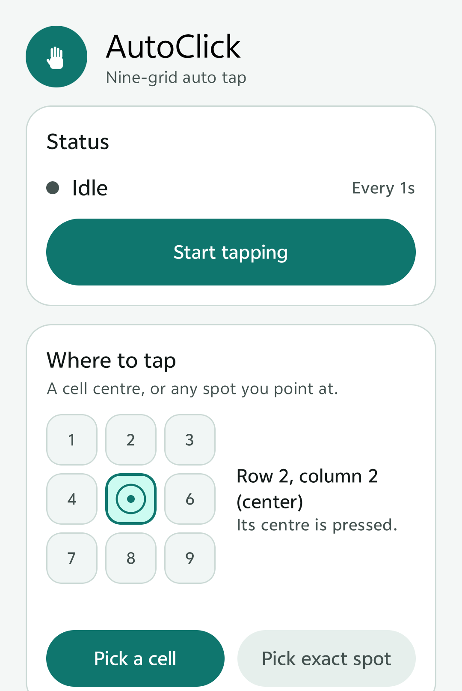
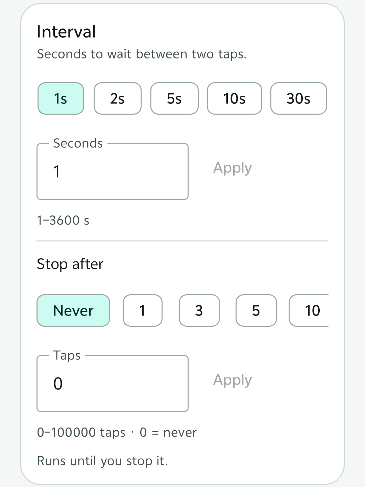
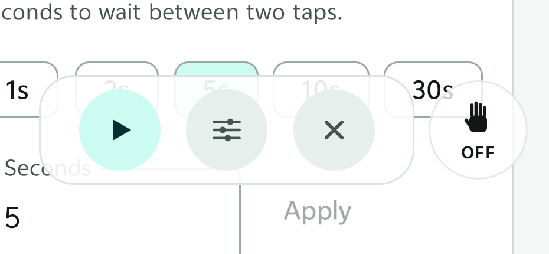

# AutoClick

**Taps one spot on your screen, over and over, on a timer you set.**

- The screen is a 3×3 grid. Pick a cell — or pick any exact spot.
- Pick the seconds: 1 to 3600, default 1.
- Stop after a set number of taps, or run until you stop it.
- A floating hand starts, stops and retimes it from inside any app, with a countdown ring between taps.

Android 8+ · English · no network permission.

## Screenshots

  
  
  

## Install

Download the latest release APK and open it. Allow "Install unknown apps", and on Android 13+
**Settings → Apps → AutoClick → ⋮ → Allow restricted settings**.

## Use

Pick a cell, pick the seconds, press **Start**. Tap the hand to play, stop, retarget or retime.

Two switches are required — **Accessibility ("AutoClick taps")** and **Display over other apps**.
The app opens each one for you, and the accessibility list jumps to AutoClick's row itself.

## Docs

[`DESIGN.md`](docs/DESIGN.md) · [`TECH.md`](docs/TECH.md) · [`CI.md`](docs/CI.md) — MIT, see
[`LICENSE`](LICENSE).
