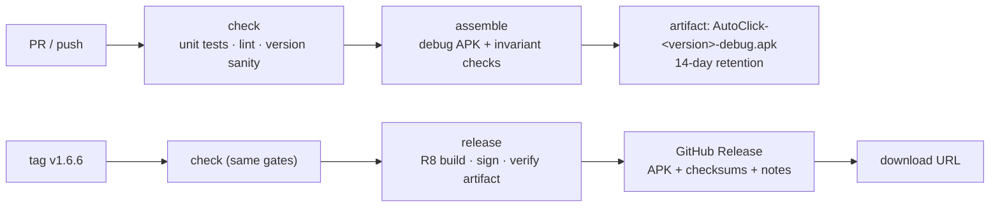

# CI/CD Plan — AutoClick

**Status: P1 and P2 implemented** in `.github/workflows/ci.yml` and `.github/workflows/release.yml`,
with the shared artifact check in `scripts/verify-apk.sh`. Decisions taken are recorded at the end of
§11; P3 (real keystore, Dependabot) is still ahead.

Repo: `activebook/auto-click` (public, MIT). Toolchain: AGP 8.13.0, Gradle 8.14.3, Kotlin 2.2.21,
`compileSdk 36`, JDK 17+ (verified locally with Temurin 21).

---

## 1. What CI/CD has to guarantee

| # | Goal | Why it matters for this app |
|---|------|-----------------------------|
| G1 | Every push and PR compiles, and the 60 unit tests pass | The timing engine and grid maths are the parts that silently break |
| G2 | `lintDebug` stays at **0 errors** | The project's own quality bar; warnings (version hints) are allowed and not enforced |
| G3 | The built APK still has **no `INTERNET` permission** | It is the app's central privacy promise; a regression here is a product lie, not a style issue |
| G4 | A tag produces a downloadable APK, once, with no laptop involved | Automated via GitHub Actions on `v*.*.*` tags |
| G5 | The artifact's `versionName` / `versionCode` match the source | Prevents a release whose file name and manifest disagree |
| G6 | Results are reproducible from the repo alone | Pinned toolchain, cached Gradle, no local `local.properties` dependency |

## 2. Explicit non-goals

- **No instrumented or emulator tests.** Tap accuracy, overlay lifetime, and the accessibility
  hand-off are verified on a physical phone (see `TECH.md` §10); an emulator would test a different
  app. CI stays at build + unit + lint + artifact invariants.
- **No Play Store upload.** Distribution is a sideloaded APK by design (`TECH.md` §12).
- **No automatic version bumping.** `versionCode`/`versionName` are deliberate (`TECH.md` §9); a
  bot changing them would break the tag↔version invariant it is meant to protect.
- **No auto-merge, no release-on-merge.** Releases are cut from tags, deliberately.
- **No secrets in the repo, ever.** Signing material goes into Actions secrets only.

## 3. Trigger matrix

| Trigger | Jobs | Outcome |
|---|---|---|
| `pull_request` → `main` | `check` → `assemble` | PR is mergeable only when green; APK downloadable from the run for 14 days |
| `push` → `main` | `check` → `assemble` | Same gate on trunk, so `main` is always buildable |
| `push` tag `v*.*.*` | `check` → `release` | Tag is validated against `versionName`, release APK built, GitHub Release published with assets |
| `workflow_dispatch` | `check` → `assemble` (+ optional release) | Manual re-run after a runner hiccup; the only path that can re-publish a tag |
| `schedule` (weekly) | `assemble` | Catches a broken dependency resolution / runner-image change with no code change |
| `pull_request` touching `.github/**` or `gradle/**` | same as PR | Toolchain changes are gated like code |

`concurrency: group: <workflow>-<ref>, cancel-in-progress: true` — a new push to the same branch
cancels the superseded run instead of paying for both.

## 4. Pipeline



## 5. Job specifications

### 5.1 `check` (every trigger, ~4–5 min warm)

| Step | Command / action | Notes |
|---|---|---|
| Checkout | `actions/checkout@v4` | `fetch-depth: 0` only for the tag job (needs tags) |
| JDK | `actions/setup-java@v4`, Temurin **21**, `distribution: temurin` | Matches the verified local JDK |
| Gradle cache | `gradle/actions/setup-gradle@v4` | Caches `~/.gradle` and the wrapper distribution; removes ~90 s cold download |
| Android SDK | Runner's pre-installed `sdkmanager`, installing `platforms;android-36` and `build-tools;36.0.0` | `setup-android@v3` tries to install the removed `tools` package and fails on current images |
| SDK path | export `ANDROID_SDK_ROOT` and `ANDROID_HOME` | `local.properties` must **not** be needed — AGP falls back to the env var |
| Workflow YAML | `python3 scripts/check-workflows.py` | Catches YAML scalar syntax mistakes before GitHub silently drops triggers |
| Unit tests | `./gradlew :app:testDebugUnitTest --stacktrace` | 60 tests; any failure fails the job |
| Lint | `./gradlew :app:lintDebug --stacktrace` | Job fails on `error`; 13 dependency-version warnings are expected and tolerated |
| Report | upload `app/build/reports/tests/**` and `lint-results-debug.html` on failure | Makes a red run actionable without a re-run |

### 5.2 `assemble` (push / PR, ~2 min after `check`)

| Step | Command | Notes |
|---|---|---|
| Build | `./gradlew :app:assembleDebug` | Also refreshes `dist/AutoClick-<version>-debug.apk` via the existing `finalizedBy` copy |
| Invariant: no network | `aapt2 dump badging <apk> \| grep -q "android.permission.INTERNET" && exit 1` | G3, enforced on the artifact, not the manifest source |
| Invariant: version | compare `aapt2 dump badging` `versionName` with `app/build.gradle.kts` | G5 |
| Invariant: permissions list | assert exactly the six expected `uses-permission` entries | A new permission is a design decision, so it should fail a build |
| Artifact | `actions/upload-artifact@v4`, name `AutoClick-<version>-debug` | Retention 14 days; no APK committed to git for each push |

### 5.3 `release` (tag only)

| Step | Command | Notes |
|---|---|---|
| Tag ↔ version guard | `tag=${GITHUB_REF_NAME#v}` vs `versionName` parsed from `app/build.gradle.kts` | Fails fast with a one-line message; prevents `v1.2.1` shipping a `1.2.0` binary |
| Tag is on `main` | `git merge-base --is-ancestor $GITHUB_SHA origin/main` | No releases from a side branch |
| Signing | see §6 | Either the real keystore from secrets, or the debug key with an explicit warning in the notes |
| Build | `./gradlew :app:assembleRelease` | R8; the accessibility deep link is already proven to survive it |
| Verify | `aapt2 dump badging dist/AutoClick-<version>.apk` → version, `minSdk 26`, `targetSdk 36`, no INTERNET | Same invariants as §5.2, on the release artifact |
| Checksums | `sha256sum dist/*.apk > SHA256SUMS.txt` | Attached to the release; the local file already has a recorded hash |
| Publish | `gh release create "$GITHUB_REF_NAME" --notes-file … dist/AutoClick-<version>.apk SHA256SUMS.txt` | Uses the built-in `GITHUB_TOKEN`, `permissions: contents: write`; if the release exists, `gh release upload --clobber` |

Two things are deliberately read from **`main`, not from the tag**: the release notes and
`scripts/verify-apk.sh` itself. A tag can predate a check or a notes file (`v1.2.0` predates both),
and the checks that matter are the current ones while the artifact is whatever that tag built. The
run emits a warning when the fallback fires.

Release notes source: **`docs/releases/<version>.md`**, written when the version is bumped and
reviewed like code. A missing notes file fails the job rather than publishing an empty release.

## 6. Signing: two options

| | A. Debug key (today) | B. Real keystore in secrets (recommended) |
|---|---|---|
| Setup | none | `KEYSTORE_BASE64`, `KEYSTORE_PASSWORD`, `KEY_ALIAS`, `KEY_PASSWORD` in Actions secrets |
| How | AGP falls back to the debug keystore when `keystore.properties` is absent | CI decodes base64 into `$RUNNER_TEMP/autoclick.jks` and writes a **git-ignored** `keystore.properties` at the repo root before building |
| Install over existing | only if CI carries **this** machine's debug key (see §6.1) — a runner's own debug key cannot | only with the same key as previous builds |
| Store-grade | no | yes, once the key is generated and **backed up outside the repo** |
| Risk | anyone can produce a same-key build | losing the key means users must uninstall to take an update |

`keystore.properties`, `*.jks` and `*.keystore` are already ignored; the CI step writes them into a
temporary path and never commits them. The base64 secret is never printed — the decode step masks the
value and the file is deleted in an `always()` step.

Recommendation: **start with A** (keeps today's install behaviour and needs zero setup), and move to
B when the app stops being a personal tool. Switching later is a one-time uninstall on the phone.

### 6.1 What A actually requires — verified, not assumed

A debug keystore is generated **per machine** (`~/.android/debug.keystore`). The first CI-built
release was therefore signed by a completely different key than the build installed on the phone:

```
runner build   cert SHA-256 1f:b2:5e:24:…   -> INSTALL_FAILED_UPDATE_INCOMPATIBLE over the install
local  build   cert SHA-256 d9:fd:76:0f:…   -> the cert actually on the device
```

So "debug key" alone is not enough for a release channel; it has to be **one specific debug key**.
The pipeline therefore stores it as the repository secret `DEBUG_KEYSTORE_BASE64` (base64 of
`~/.android/debug.keystore`, alias `androiddebugkey`, password `android`), decodes it to
`debug-ci.keystore` at the repo root, writes a `keystore.properties` next to it (both git-ignored),
builds, and deletes both in an `always()` step. If the secret is missing the job still builds, but
says so in a warning and the artifact is not installable over an existing copy.

Two other facts, measured rather than hoped for:

- Builds from the same commit are **not byte-identical** (zip timestamps differ), so the release hash
  changes between runs. `SHA256SUMS.txt` is therefore published per run and asserted against the
  uploaded asset's own digest, not against an older hash.
- The signed-and-zipaligned APK is ~1.3 MB; the invariant script reports the hash it actually saw.

## 7. Guardrails worth their cost

| Guard | Cost | Catches |
|---|---|---|
| Tag ↔ `versionName` | 5 s | The single most common release bug |
| No `INTERNET` in the artifact | 2 s | A dependency or a manifest edit quietly adding network access |
| Exact permission list | 2 s | Scope creep that the design promised not to take |
| `dist/` has exactly the current version | 1 s | Stale APK shipped alongside the release (the 11.5 MB 1.1.0 debug file is the precedent) |
| Tag only from `main` | 1 s | Releasing an experiment |
| `SHA256SUMS.txt` attached | 1 s | Silent asset corruption; matches the hash recorded in the docs |
| Secret scanning | free | GitHub's own scanner on public repos; the repo deliberately holds no credentials |

## 8. Repo hygiene the pipeline relies on

- `main` is the only long-lived branch; features go through short-lived branches + PR.
- `dist/` stays tracked for **one** current APK (`.gitignore` exception), so a release asset and the
  in-repo download never diverge; every assemble refreshes it.
- `.github/**` changes are gated like source: a workflow that loosens a check is a reviewed diff.
- Actions are pinned by major tag (`@v4`) now, and by commit SHA once the pipeline is stable — the
  supply-chain hardening step, not the first step.

## 9. Rollout

| Phase | Scope | Exit criteria | Est. effort |
|---|---|---|---|
| **P1** | `ci.yml`: `check` + `assemble` on PR and `main`, artifacts, invariants | A deliberately broken test turns the PR red; a clean PR is green in < 8 min | 1 workflow file, ~1 h incl. debugging runner SDK 36 |
| **P2** | `release.yml`: tag guard, release build, publish, checksums, notes file | Re-tagging `v1.2.0` on a scratch tag publishes assets identical (hash-equal) to the hand-cut release | 1 workflow + `docs/releases/1.2.0.md` |
| **P3** | Signed releases (option B), Dependabot for Gradle + Actions, weekly schedule | A signed APK installs over the previous one; a dependency PR runs the full gate | ~1 h, needs the keystore decision |
| **P4** | Optional: CodeQL (Kotlin), `gradle/actions/dependency-submission`, SHA-pinned actions, build provenance | Supply-chain posture review passes | optional |

## 10. Risks and mitigations

| Risk | Likelihood | Mitigation |
|---|---|---|
| `platforms;android-36` missing on the runner image | medium on first run | Explicit `sdkmanager` install in `check`; cache the SDK dir keyed by the version list |
| AGP 8.13 + JDK mismatch | low | `setup-java` Temurin 21, same as local verification |
| Cold Gradle build exceeds the 6 h job cap | very low | `setup-gradle` cache; the whole build is ~2 min warm |
| Actions minutes | none | Public repo → standard runners are free; caching is politeness, not budget |
| A workflow edit weakens a gate silently | low | `.github/**` changes are reviewed like code; each guard fails loudly with a message naming itself |
| Debug-key releases mistaken for store-grade | medium | The release body states the signing key in one line; README says the same |
| Tag pushed for an abandoned version | low | Tag guard + `main`-ancestor check + manual `workflow_dispatch` as the only re-publish path |

## 11. Decisions

1. **Signing:** start with the debug key (A), or generate and store a real keystore now (B)?
2. **Publish trigger:** any `v*.*.*` tag publishes automatically, or should publishing require a
   second `workflow_dispatch` confirmation?
3. **Extras in P1:** include the permission/version invariant checks from day one, or keep P1 to
   tests + lint + artifact and add them in P2?
4. **Dependabot:** enable now (weekly Gradle + Actions PRs), or wait until the pipeline is stable?

My recommendation: **A → auto-publish on tag → invariants from day one → Dependabot in P3.** The
invariants are two seconds each and they are the only automated defence of the app's privacy claim;
everything else can wait.

### Decisions taken

| Question | Decision |
|---|---|
| Signing | **A — debug key**, supplied to CI as the `DEBUG_KEYSTORE_BASE64` secret so CI builds carry the same cert as local builds (§6.1) |
| Publish trigger | **Any `v*.*.*` tag publishes automatically.** `workflow_dispatch` exists only for a re-run / verification, with a `publish` toggle defaulting to off |
| Invariants in P1 | **Yes — all three** (no INTERNET + designed permissions only, version match, `dist/` holds only the current version) |
| Dependabot | **P3**, not now |

---

## 12. Live evidence

| Run | What it proved |
|---|---|
| [44305156114](https://github.com/activebook/auto-click/actions/runs/44305156114) | `check` + `assemble` green in 2 min 9 s on `main`; the debug artifact passed all three invariants |
| [44305203342](https://github.com/activebook/auto-click/actions/runs/44305203342) | `release` dry-run (`publish=false`): tag↔version guard, trunk guard, notes fallback, R8 build, artifact verified — nothing published |
| [44305860615](https://github.com/activebook/auto-click/actions/runs/44305860615) | Existing release → `gh release upload --clobber` + notes edit; `SHA256SUMS.txt` added |
| [44306991417](https://github.com/activebook/auto-click/actions/runs/44306991417) | Build signed with the project's key: cert `d9:fd:76:0f:…`, identical to the installed app |
| — | `adb install -r` of the resulting asset over the installed build: `Success`, `lastUpdateTime` moved to 20:48 |

Three failures were found and fixed on the way, each a real design lesson rather than a typo:

1. `android-actions/setup-android@v3` installs the removed `tools` package and dies on current
   images → use the SDK the runner already ships, install only `platforms;android-36` and
   `build-tools;36.0.0`.
2. A `run:` value starting with `"` parses as a quoted scalar with trailing text → the **whole**
   workflow file is invalid, GitHub silently drops every trigger (the workflow still appears in the
   list, named by its path) → `scripts/check-workflows.py` now gates workflow YAML on every run.
3. A tag can predate the checks and the notes → gates and notes come from `main`, the artifact from
   the tag; the fallback is a visible warning, not a silent pass.

## Appendix — file set

```
.github/
├─ workflows/
│  ├─ ci.yml        # check + assemble on PR / push / schedule, artifact invariants
│  └─ release.yml   # tag guards, key restore, R8 build, verify, publish
└─ dependabot.yml   # gradle + github-actions, weekly (P3, not yet added)
docs/releases/
└─ <version>.md     # release notes, reviewed like code (1.2.0.md–1.6.6.md)
scripts/
├─ verify-apk.sh    # the artifact gate (also usable by hand)
└─ check-workflows.py
```
