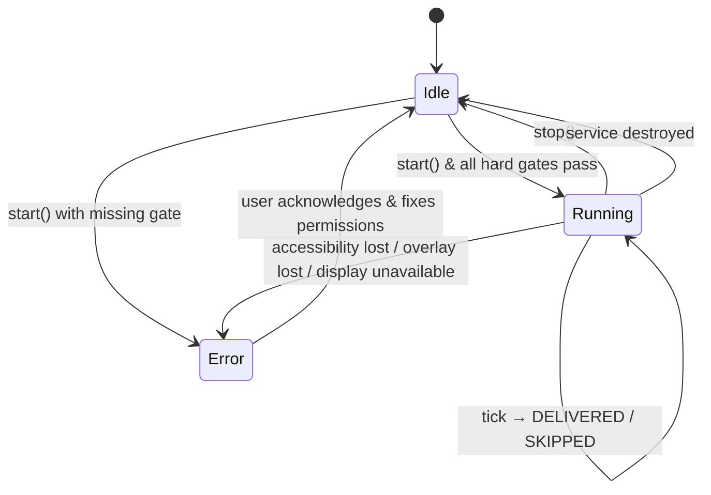

# AutoClick — Android Auto-Tap App
## Technical Design & Implementation Plan (v1.0, 2026-11-18)

> Status: **Approved and implemented (v1.0, 2026-11-18).** §1–§14 are the design as proposed;
> **§15 records every place the shipped code deviates from it, and why.**
>
> This file is the *history*: what was planned, tried, measured and rejected. The current design is
> maintained in [`DESIGN.md`](DESIGN.md) (product + UX) and [`TECH.md`](TECH.md) (engineering).
> Where the three disagree, DESIGN/TECH are the shipped truth and §15 is the audit trail.
> Scope of this document: requirements, architecture, key decisions (ADR), data contracts,
> state machine, module layout, permission flow, failure matrix, test strategy, milestones.
> No production code is written until this plan is approved.

---

## 1. Requirement Understanding (restated in precise terms)

### 1.1 What the user asked for

1. An **Android app** that can **automatically tap a location on the phone screen** at a **configurable period**.
2. The screen area is conceptually divided into a **3×3 nine-grid**; the user picks **which cell** to tap.
3. The app shows a **floating hand icon** on top of other apps.
4. Tapping that hand icon reveals a control panel with:
   - **Start / Stop** (run state toggle)
   - **Settings** (target cell + interval)
   - **Minimize / Open** (collapse back to the hand bubble / expand the panel)

### 1.2 Functional requirements (FR)

| ID | Requirement | Notes |
|----|-------------|-------|
| FR-1 | Floating bubble with a hand icon, visible over other apps, draggable, persists until explicitly closed | Overlay window, survives app switching |
| FR-2 | Tap bubble → expand panel with Start/Stop, Settings, Minimize | Single tap toggles expand/collapse; drag does not trigger the panel |
| FR-3 | Settings: 3×3 grid selector; user taps a cell to make it the target | Preview grid in-app + optional "pick on the real screen" mode |
| FR-4 | Settings: interval — user enters the period between taps (support ms / s / min units) | Persisted; validated with a minimum bound |
| FR-5 | Start → the app taps the **center of the selected cell** every interval, indefinitely, until Stop | Must keep working while the user is in *any* other app |
| FR-6 | Stop → immediate stop, no pending tap fires afterwards | Cancels scheduler + in-flight gesture |
| FR-7 | Config persists across app restart, service restart, device reboot (overlay restore is optional/opt-in) | DataStore |
| FR-8 | Live status feedback: running state, tap count, last tap result, target crosshair flash | Bubble badge + panel + notification |
| FR-9 | Graceful failure: if overlay permission or accessibility is revoked mid-run → stop and explain | No silent zombie state |
| FR-10 | (Derived) Onboarding checklist screen for the 3 required permissions, each with "why" and a deep link | Reduces first-run failure |

### 1.3 Non-functional requirements (NFR)

| ID | Requirement | Target / measurement |
|----|-------------|----------------------|
| NFR-1 | Tap position accuracy | Center of cell ± 4 px on any density; recomputed per orientation |
| NFR-2 | Timing accuracy | Mean drift ≤ 1 % of interval; no cumulative drift (anchored scheduling) |
| NFR-3 | Efficiency | Idle CPU ≈ 0 %; running at 1 s interval < 2 % CPU on a mid-range device; no wake-lock when screen on |
| NFR-4 | Robustness | No crash on rotation, screen-off/on, permission revocation, service kill, OEM task killers |
| NFR-5 | Privacy | **No INTERNET permission, no analytics, no telemetry, no window-content reading** |
| NFR-6 | Footprint | APK < 8 MB; release build minified with R8 |
| NFR-7 | Maintainability | Pure-Kotlin domain layer, unit-testable geometry/timing; no business logic inside Service classes |

### 1.4 Explicit non-goals (v1)

- Multi-point sequences / macros / recorded gesture playback (single cell in v1 — see Open Question Q2).
- Root / shell (`adb input tap`) execution — deliberately not used (see ADR-001).
- Reading screen content, OCR, image recognition, conditional automation.
- Cloud sync, accounts, ads, subscription.
- iOS / desktop.

### 1.5 Acceptance criteria (Definition of Done for v1)

1. Fresh install on a physical device → onboarding lists exactly 3 items (Overlay, Accessibility, Battery) and each deep link lands on the correct system page.
2. After enabling permissions, the hand bubble appears within 1 s and can be dragged; its position survives process restart.
3. Selecting cell 5 (center) and interval 1000 ms, then Start in a third-party app (e.g. Chrome): the app receives ~60 taps/min on the cell center, and the visible tap count matches wall clock within 1 %.
4. Stop → zero taps after the Stop command is acknowledged (verified over 10 s window).
5. Rotate the device while running → taps follow the same *logical* cell (fractions of the usable display) within one tick.
6. Revoke accessibility permission while running → state becomes `Error`, scheduler stops, a snackbar/notification explains the fix; no crash.
7. `./gradlew :app:assembleRelease` succeeds, R8 passes, APK installs and runs with no `INTERNET` permission in `aapt dump badging`.

---

## 2. Assumptions (change these and the plan changes)

| # | Assumption | Impact if wrong |
|---|-----------|-----------------|
| A1 | App is installed **by sideload / internal distribution**, not Google Play | Play policy forbids Accessibility API for non-accessibility purposes → distribution + onboarding copy change |
| A2 | No root on the target device | If root is allowed, an alternative `su -c input tap` path could be added as a fallback engine |
| A3 | The user has an Android 8.0+ (API 26) physical device for testing | Emulator cannot validate real overlay/accessibility behaviour |
| A4 | Package namespace `com.autoclick.app`, app label **AutoClick**, English UI | Renaming is cheap at M0, expensive later |
| A5 | Interval range 100 ms – 24 h, single fixed interval, optional ±jitter | Changes config model + validation |

---

## 3. Architecture

### 3.1 Component diagram

```mermaid
flowchart TD
    subgraph AppProcess["Single app process"]
        UI["MainActivity\n(Compose: onboarding, settings, grid picker)"]
        DS[("DataStore\nClickerConfig")]
        CO["ClickerCoordinator\n(singleton, StateFlow&lt;ClickerState&gt;)"]
        SCH["TickScheduler\n(HandlerThread, anchored timing)"]
        OSVC["OverlayService\n(foreground service, specialUse)"]
        ACC["AutoClickAccessibilityService\n(gesture injection)"]
        WM["WindowManager\nbubble + panel + crosshair windows"]
        UI -->|read/write| DS
        OSVC -->|observe| DS
        OSVC --> WM
        OSVC --> SCH
        SCH -->|tick| CO
        CO -->|tap(x,y)| ACC
        ACC -->|GestureResult| CO
        CO -->|state| OSVC
        CO -->|state| UI
    end
    ACC -->|injects touch| INP["Android input pipeline"]
    INP --> TGT["Foreground app under the tap coordinates"]
```

Key point: the **accessibility service is the only component that can inject a real tap**; everything else is orchestration, UI, and persistence. They all live in the same process, so a plain singleton + `StateFlow` is a valid, dependency-free channel (ADR-002).

### 3.2 Layer boundaries (enforced by package structure)

```
com.autoclick.app
├── domain/            # pure Kotlin: no android.* except value types
│   ├── model/         # ClickerConfig, ClickerState, GridCell, TapResult
│   ├── geometry/      # GridGeometry: cell rect/center math (unit-tested)
│   └── timing/        # IntervalMath: anchored schedule (unit-tested)
├── data/              # DataStore repository, config mapping
├── platform/          # permission checks, WindowManager, notification, wakelock
├── service/
│   ├── accessibility/ # AutoClickAccessibilityService (thin: only gesture dispatch)
│   └── overlay/       # OverlayService (FGS), OverlayController, windows
├── ui/                # Compose screens, theme, overlay composables
└── app/               # Application, manual DI container
```

Rule: **Services contain no scheduling logic and no geometry logic.** They call the domain layer, so 100 % of accuracy-critical code is JVM-unit-testable without a device.

### 3.3 Core interaction sequence (one tick)

```mermaid
sequenceDiagram
    participant S as TickScheduler
    participant C as Coordinator
    participant A as AccessibilityService
    participant I as Input pipeline
    S->>C: onTick(n) (uptimeMillis == anchor + n*interval)
    C->>C: read config, compute cell center from current display metrics
    alt in-flight gesture still running
        C->>C: skip tick, increment skipped counter
    else bubble overlaps target point
        C->>C: params |= FLAG_NOT_TOUCHABLE; updateViewLayout; wait 1 frame
    end
    C->>A: dispatchGesture(stroke 55 ms)
    A->>I: touch DOWN/MOVE/UP at (x, y)
    I-->>A: delivered to app under coordinates
    A-->>C: onCompleted / onCancelled
    C->>C: restore overlay flags, schedule next anchor, emit state(tapCount+1)
```

---

## 4. Architecture Decision Records

### ADR-001 — Gesture injection engine: AccessibilityService `dispatchGesture`

**Status**: Accepted

**Context**: Tapping another app's UI requires injecting input events at a privilege level normal apps do not have. Options:

| Option | Mechanism | Requires | Verdict |
|--------|-----------|----------|---------|
| A. AccessibilityService | `dispatchGesture(GestureDescription)` (API 24+) | User enables the service once | **Chosen** |
| B. Root shell | `su -c "input tap x y"` | Rooted device, per-tap process fork (~100–300 ms overhead, very poor for sub-second intervals) | Rejected — not universal, high latency |
| C. `adb` over USB | `adb shell input tap` | Permanent PC connection | Rejected — unusable standalone |
| D. `MotionEvent` injection via reflection / `InputManager.injectInputEvent` | hidden API | System signature / root | Rejected — fragile, blocked by hidden-API enforcement |
| E. MediaProjection + virtual display | cannot inject input without B | — | Rejected |

**Decision**: Accessibility service with `android:canPerformGestures="true"`. One service, declared in the manifest, `canRetrieveWindowContent="false"` so we request the minimum privilege (privacy + trust).

**Consequences**
- Positive: no root, works on any modern device, tap latency ~1–2 frames, interval can go down to ~100 ms.
- Negative: user must enable the service in system Settings; the service can be disabled by the system/OEM at any time (must handle); Google Play distribution is effectively excluded; on Android 13+ sideloaded apps need "Allow restricted settings" before the accessibility toggle becomes available.
- Mitigation: onboarding explains exactly what to enable and why; runtime watchdog reconciles state every 2 s and stops gracefully.

### ADR-002 — Process topology: one foreground `OverlayService` + one AccessibilityService + singleton coordinator

**Status**: Accepted

**Context**: AccessibilityService is started/stopped by the system, not by us. A long-running overlay must live in a foreground service (Android requires FGS for persistent overlays and to avoid the process being killed). Two services in the same process need a channel.

**Decision**
- `OverlayService` (`foregroundServiceType="specialUse"`) owns: bubble/panel windows, the scheduler, the notification, the wakelock policy.
- `AutoClickAccessibilityService` owns: only `dispatchGesture` + connectivity state, registered into `ClickerCoordinator` as a `ClickSink`.
- `ClickerCoordinator` is a process singleton exposing `StateFlow<ClickerState>`; start/stop commands enter from the overlay panel, the notification actions, and MainActivity.

**Alternatives rejected**: binding to AccessibilityService (the framework does not expose a bindable instance to third-party apps); a separate scheduler process (extra IPC, no benefit); running the loop *inside* the accessibility service (works, but then we cannot guarantee overlay lifetime, notification UX, or a clean stop when the service is disabled).

**Consequences**: single-process, zero IPC; the accessibility service must be defensive — if it is null/disconnected, ticks fail fast with `Error(NoAccessibility)`, not a crash.

### ADR-003 — UI stack: Kotlin 2.x + Jetpack Compose (Material 3), including the overlay

**Status**: Accepted (with documented fallback)

**Decision**: Compose for the app UI and for the overlay bubble/panel, hosted in the WindowManager via `ComposeView` + a small `OverlayLifecycleOwner` (implements `LifecycleOwner`, `ViewModelStoreOwner`, `SavedStateRegistryOwner`, and drives `SavedStateRegistryController.performRestore(null)` + lifecycle events). Rationale: one design system, one theme, trivial animations (panel expand, crosshair flash), no XML/maintainability split.

**Risk & fallback**: Compose inside a raw WindowManager window is a known but non-default pattern; if we hit lifecycle/animation jank in M3, switch the bubble+panel to a single XML view (`ViewBinding`) while keeping Compose for activities. This swap is isolated to `platform/overlay` and does not touch domain logic.

**Consequences**: overlay must be measured with `WRAP_CONTENT` and updated via `updateViewLayout` when the panel expands; all window flags handled explicitly (see §7.3).

### ADR-004 — Persistence: DataStore Preferences + immutable domain config

**Status**: Accepted

**Decision**: `androidx.datastore:datastore-preferences`, one `ClickerConfig` mapping (grid cell index, interval ms, jitter, screen-off policy, avoid-system-bars, haptics). No Room, no JSON: the payload is ~8 scalar keys.

**Consequences**: async, single-writer safe, no migrations needed for v1; if v2 adds macros (list of steps), migrate to Proto DataStore or Room — the repository interface insulates that change.

### ADR-005 — Coordinate model: normalized fractions of the *usable* display, resolved at fire time

**Status**: Accepted

**Context**: Absolute pixel coordinates break on rotation, resolution change, split-screen, and multi-display.

**Decision**
- Domain stores the target as `GridCell(index ∈ 0..8)` — i.e. a *logical* position.
- At each tick, `GridGeometry.cellCenter(index, bounds, insets, avoidBars)` computes the pixel point from the **current** `WindowManager.maximumWindowMetrics` bounds (API 30+; `getRealMetrics` fallback), excluding status/nav bar insets when `avoidSystemBars = true`.
- No absolute pixel is ever persisted.

**Consequences**: rotation/split-screen correctness for free; tap lands on cell center even if the underlying app layout differs (that is intended: the grid is a *screen* grid, not an app grid).

### ADR-006 — Timing: anchored `Handler` scheduling on a `HandlerThread`, not `AlarmManager`

**Status**: Accepted

**Decision**
- Anchor: `anchorUptime = SystemClock.uptimeMillis()` at start; tick *n* fires at `anchor + n * interval`. `postAtTime` with the absolute target → **no cumulative drift**, self-correcting after scheduler jitter.
- Missed ticks: if `now - target > interval` (e.g. process suspension), skip ahead to the next future anchor and count a `skipped` metric instead of firing a burst.
- `AlarmManager` rejected: exact alarms need permission on Android 12+, minimum practical interval is seconds, and idle/doze batching destroys sub-second accuracy.
- Screen-off policy (ADR-006a): if `keepRunningScreenOff` is enabled → acquire `PARTIAL_WAKE_LOCK` while running (release on stop) so `uptimeMillis` keeps advancing; otherwise pause on `ACTION_SCREEN_OFF` and resume on `ACTION_USER_PRESENT`.
- Optional `jitterFraction` (±%) to appear less mechanical, computed from the anchor only (no drift accumulation).

**Consequences**: accuracy is bounded by `dispatchGesture` round-trip, typically 1–2 frames; minimum crafted gesture duration 55 ms keeps the stroke a real tap and avoids double-tap interpretation.

### ADR-007 — Overlay must not swallow its own injected taps

**Status**: Accepted (this is the subtle correctness bug most auto-clickers ship with)

**Context**: A touchable overlay window receives *injected* accessibility touches exactly like a real finger. If the hand bubble sits over the chosen cell, the tap hits the bubble instead of the app underneath, and the feature silently "does nothing".

**Decision**, two layers:
1. **Static guard**: on selecting a cell / moving the bubble, if the target point lies inside the bubble (or panel) bounds + 8 dp margin → show a warning chip and offer "move bubble away".
2. **Runtime guard**: at tick time, if the target point intersects overlay bounds → set `FLAG_NOT_TOUCHABLE` on the overlay params, `updateViewLayout`, wait one frame (`Choreographer.postFrameCallback`), dispatch the gesture, then restore flags in the `GestureResultCallback`. Fast path (no overlap) skips this entirely so the two layout passes are not paid on every tick.

**Consequences**: correctness in the corner case without a per-tick performance tax.

### ADR-008 — Distribution & compliance posture: sideload, zero network, minimum privileges

**Status**: Accepted

**Decision**
- Deliver `app-release.apk` (+ debug APK) for direct installation; document "Allow restricted settings" for Android 13+ sideloaded accessibility apps.
- Manifest: **no** `INTERNET`, no `ACCESS_NETWORK_STATE`, no analytics SDK, `canRetrieveWindowContent=false`, no `QUERY_ALL_PACKAGES`.
- Permissions requested: `SYSTEM_ALERT_WINDOW`, `FOREGROUND_SERVICE`, `FOREGROUND_SERVICE_SPECIAL_USE`, `POST_NOTIFICATIONS` (33+), `REQUEST_IGNORE_BATTERY_OPTIMIZATIONS` (optional, guided only), `WAKE_LOCK` (only if screen-off mode exists), `RECEIVE_BOOT_COMPLETED` (optional restore).
- In-app disclosure screen states plainly: this app taps the screen for you; it does not read your screen or your data.

---

## 5. Technology & Build Baseline

| Item | Choice | Reason |
|------|--------|--------|
| Language | Kotlin 2.2.x | Current, Compose-compatible compiler plugin |
| UI | Jetpack Compose (BOM 2025.xx), Material 3 | Single design system incl. overlay |
| Build | AGP 8.13.0, Gradle 8.14.3 (cached locally), Kotlin DSL, version catalog `libs.versions.toml` | Matches the machine's cache → fast, reproducible |
| SDK | `compileSdk = 36`, `targetSdk = 36`, `minSdk = 26` | 26 = `TYPE_APPLICATION_OVERLAY` + `dispatchGesture` baseline; 36 = current store requirement |
| Async | Coroutines + Flow (`StateFlow`) | Unidirectional data flow |
| DI | Manual `AppContainer` (no Hilt) | 5 components; annotation processing not justified |
| Storage | DataStore Preferences | ADR-004 |
| Tests | JUnit4 + `kotlin.test`, Robolectric (permission gating), Compose UI test, ktlint + Detekt | Accuracy code is pure Kotlin |
| Signing | Debug: default; Release: local keystore `keystore/autoclick-release.jks` (git-ignored) | Installable release build |
| CI | GitHub Actions: `assembleDebug`, `testDebugUnitTest`, `lintDebug`, `assembleRelease` artifact | Golden-standard gate |

Machine state verified: JDK 21 (Temurin), Android SDK platforms 35/36, build-tools 35/36, Gradle 8.14.3 + AGP 8.13.0 cached, network reachable, **no emulator image and no adb device attached** → see §11 M0.

---

## 6. Data Contracts

```kotlin
// domain/model/ClickerConfig.kt
@Immutable
data class ClickerConfig(
    val cellIndex: Int = 4,                 // 0..8, row-major; 4 = center
    val intervalMs: Long = 1000L,           // clamped 100..86_400_000
    val jitterFraction: Float = 0f,         // 0f..0.2f, ± of interval
    val avoidSystemBars: Boolean = true,
    val keepRunningScreenOff: Boolean = false,
    val hapticOnTap: Boolean = false,
    val flashlightOnTap: Boolean = false,   // crosshair flash at tap point
) {
    init { require(cellIndex in 0..8) { "cellIndex out of range: $cellIndex" } }
}

// domain/model/ClickerState.kt  (single source of truth for UI + notification)
sealed interface ClickerState {
    data object Idle : ClickerState
    data class Running(
        val startedAtUptime: Long,
        val tapCount: Long,
        val lastTapAtUptime: Long?,
        val lastResult: TapResult?,
        val skippedTicks: Long,
    ) : ClickerState
    data class Error(val reason: FailureReason, val detail: String? = null) : ClickerState
}

enum class TapResult { DELIVERED, CANCELLED, SKIPPED_OVERLAP, SKIPPED_IN_FLIGHT, NOT_READY }

enum class FailureReason { NO_OVERLAY_PERMISSION, NO_ACCESSIBILITY, SERVICE_DISCONNECTED, DISPLAY_UNAVAILABLE }

// domain/geometry — pure, unit tested
object GridGeometry {
    fun cellBounds(index: Int, area: RectF): RectF            // thirds of area
    fun cellCenter(index: Int, area: RectF): PointF           // center of that third
    fun usableArea(display: RectF, insets: Insets, avoidBars: Boolean): RectF
}

// domain/timing — pure, unit tested
object IntervalMath {
    fun nextAnchor(anchor: Long, intervalMs: Long, now: Long): Long   // skips missed ticks
    fun delayUntil(anchor: Long, n: Int, intervalMs: Long): Long
}

// service/accessibility — the only Android-facing sink
interface ClickSink {
    val connected: Boolean
    suspend fun tap(x: Float, y: Float, durationMs: Long = 55L, timeoutMs: Long = 400L): TapResult
}
```

Coordinator contract:

```kotlin
class ClickerCoordinator(
    private val sink: ClickSink,
    private val config: StateFlow<ClickerConfig>,
) {
    val state: StateFlow<ClickerState>
    fun start()   // validates preconditions → Running | Error
    fun stop()    // cancels scheduler, restores overlay flags
    fun onAccessibilityConnected() / onAccessibilityDisconnected()
}
```

Config → validation rules: interval clamped and echoed back to the user; cell index validated; jitter ≤ 20 %; unit selector (ms/s/min) maps to ms at the boundary, no float math in the stored value.

---

## 7. Detailed Design

### 7.1 Onboarding / permission state machine (permission gates before `start()`)

| Gate | Detection | Deep link | Failure mode if missing |
|------|-----------|-----------|-------------------------|
| Overlay (`SYSTEM_ALERT_WINDOW`) | `Settings.canDrawOverlays(ctx)` | `ACTION_MANAGE_OVERLAY_PERMISSION` + `package:` | No bubble at all → advisory screen, cannot start |
| Accessibility | `AccessibilityManager.getEnabledAccessibilityServiceList` contains our component (or `Settings.Secure.ENABLED_ACCESSIBILITY_SERVICES` parse) | `ACTION_ACCESSIBILITY_SETTINGS` | `Error(NO_ACCESSIBILITY)`, start button disabled |
| Notification (33+) | `POST_NOTIFICATIONS` runtime grant | system dialog | FGS runs but notification may be invisible → warn only |
| Battery optimization (optional) | `PowerManager.isIgnoringBatteryOptimizations` | `ACTION_REQUEST_IGNORE_BATTERY_OPTIMIZATIONS` (guided, with manual fallback) | Long runs may be throttled on OEM ROMs → warn only |

Android 13+ sideload note shown inline: *App info → ⋮ → "Allow restricted settings"* before the accessibility toggle can be turned on.

### 7.2 Overlay UX specification

| Element | Spec |
|---------|------|
| Bubble | 52 dp circular, hand glyph (`TouchApp`/`PanTool`), 88 % opacity, 2 dp elevation, subtle "running" pulse ring (1.2 s) |
| Drag | Threshold 8 dp before drag starts; on release, snap to nearest horizontal edge with 24 dp margin animation (120 ms) |
| Tap | Toggles panel; single tap only (drag suppresses the click) |
| Panel | 56 dp tall row of 3 icon buttons — Start/Stop (turns green/red), Settings (gear), Minimize (chevron-down). Expands with 120 ms scale+fade from the bubble anchor, clamped inside screen bounds |
| Status chip | Under panel: `12 taps · next 0.8 s` or error text in `errorContainer` color |
| Crosshair flash | Optional: 24 dp ring drawn at the tap point for 180 ms — proof of execution, useful when debugging blind taps |
| Tap-outside | `FLAG_WATCH_OUTSIDE_TOUCH` + `ACTION_OUTSIDE` collapses the panel |
| Notification | Low-importance channel `clicker`, ongoing, actions: Start/Stop, Stop-all; shows tap count. Service stops when the user taps "exit" in the app |

### 7.3 WindowManager configuration (exact flags, the part that usually goes wrong)

```kotlin
val params = WindowManager.LayoutParams(
    WindowManager.LayoutParams.WRAP_CONTENT,
    WindowManager.LayoutParams.WRAP_CONTENT,
    WindowManager.LayoutParams.TYPE_APPLICATION_OVERLAY,          // API 26+
    WindowManager.LayoutParams.FLAG_NOT_FOCUSABLE or
        WindowManager.LayoutParams.FLAG_NOT_TOUCH_MODAL or
        WindowManager.LayoutParams.FLAG_WATCH_OUTSIDE_TOUCH or
        WindowManager.LayoutParams.FLAG_LAYOUT_IN_SCREEN,
    PixelFormat.TRANSLUCENT
).apply {
    gravity = Gravity.TOP or Gravity.START
    x = savedX; y = savedY
    // no FLAG_ALT_FOCUSABLE_IM: panel has no text input
}
```

Notes:
- `FLAG_NOT_FOCUSABLE` is mandatory — otherwise the bubble steals IME focus and the back key.
- `TYPE_APPLICATION_OVERLAY` clips to display bounds; position math must clamp x/y (`0..width - viewWidth`, `insets.top..height - insets.bottom - viewHeight`).
- Window count is capped at 3 (bubble, panel, crosshair) — never spawn a window per tap.
- All overlay windows are created/removed on the main thread; `updateViewLayout` is main-thread-only.

### 7.4 Accessibility service implementation sketch

```xml
<!-- res/xml/autoclick_accessibility.xml -->
<accessibility-service
    android:accessibilityEventTypes="typeWindowStateChanged"
    android:accessibilityFeedbackType="feedbackGeneric"
    android:notificationTimeout="100"
    android:canPerformGestures="true"
    android:canRetrieveWindowContent="false"
    android:description="@string/accessibility_description" />
```

```kotlin
fun tap(x: Float, y: Float, durationMs: Long): Boolean {
    if (Build.VERSION.SDK_INT < 24) return false
    val path = Path().apply { moveTo(x, y) }
    val stroke = GestureDescription.StrokeDescription(path, 0, durationMs)
    val gesture = GestureDescription.Builder().addStroke(stroke).build()
    return dispatchGesture(gesture, callback, handler)   // false ⇒ another gesture in flight
}
```

Constraints handled: `dispatchGesture` returns `false` when a gesture is already in progress (→ `SKIPPED_IN_FLIGHT`), gesture duration must be ≤ 60 s, and `onInterrupt()` / `onDestroy()` must flip the coordinator into `Error(SERVICE_DISCONNECTED)` so the scheduler stops instead of spamming failures.

### 7.5 Scheduler sketch (anchored, drift-free)

```kotlin
val thread = HandlerThread("clicker-tick").apply { start() }
val handler = Handler(thread.looper)

fun start(config: ClickerConfig) {
    anchor = SystemClock.uptimeMillis()
    tick = 0
    scheduleNext(config)
}

fun scheduleNext(config: ClickerConfig) {
    val interval = effectiveInterval(config)              // interval ± jitter
    val target = anchor + (++tick) * config.intervalMs
    val now = SystemClock.uptimeMillis()
    if (target - now > config.intervalMs) {                // missed too many: rebase
        anchor = now; tick = 1
    }
    handler.postAtTime({ onTick() }, target)
}
```

`effectiveInterval` derives a deterministic-per-tick jitter from `anchor + tick` so the schedule never drifts; `onTick` never blocks the HandlerThread — the gesture round-trip is observed via callback/flow.

### 7.6 Architecture-level state transitions



Every transition emits exactly one `ClickerState` value; UI and notification render from that flow only (no duplicated booleans).

---

## 8. Failure & Edge-Case Matrix

| # | Scenario | Behaviour | Design element |
|---|----------|-----------|----------------|
| 1 | Screen rotates | Continue; coordinates recomputed from current metrics on next tick | ADR-005 |
| 2 | Screen off / locked | Default: pause on `ACTION_SCREEN_OFF`, resume on `ACTION_USER_PRESENT`. Opt-in: keep running with partial wakelock | ADR-006a |
| 3 | Accessibility disabled mid-run | Tick fails → `Error(NO_ACCESSIBILITY)`; scheduler cancelled; notification explains | §7.4 |
| 4 | Overlay permission revoked mid-run | Window add fails → stop, `Error(NO_OVERLAY_PERMISSION)`, deep link to fix | §7.1 |
| 5 | Target cell under the bubble | Runtime `FLAG_NOT_TOUCHABLE` dance; static warning at config time | ADR-007 |
| 6 | OEM task killer (MIUI/ColorOS/HyperOS) | FGS + optional autostart guide; state reconciliation on resume | §7.1 row 4 |
| 7 | Doze / App Standby | FGS keeps process, `uptime` scheduling; wakelock only if screen-off mode | ADR-006 |
| 8 | Split-screen / multi-window | Grid uses *display* bounds; taps remain geometrically correct even if the app is windowed | ADR-005 |
| 9 | Multi-display (external screen) | v1 targets default display only; documented limitation | — |
| 10 | Gesture in flight when stopping | `stop()` cancels scheduling and marks a "dead" generation token; late callbacks are ignored | §7.5 |
| 11 | Interval < gesture duration | Validation clamps interval ≥ 100 ms; in-flight guard prevents overlap | §7.5 |
| 12 | Notification permission denied | Run anyway; panel shows the state; log-only warning | §7.1 |
| 13 | Process killed by system | On restart, bubble not auto-created unless `restoreOnBoot` is on; state = Idle | FR-7 |
| 14 | Clock/uptime reset (reboot) | Anchors are in-memory only; nothing survives as a valid schedule | §7.5 |
| 15 | Rotation during drag | Drag math uses raw `event.rawX/rawY`; reconfigure on `onConfigurationChanged` | §7.2 |

---

## 9. Test Strategy

**Unit (JVM, fast, must be 100 % green before merge)**
1. `GridGeometry`: 9 cells tile exactly; centers at 1/6, 3/6, 5/6 of usable area; insets applied; degenerate area (0 width) → no NaN.
2. `IntervalMath`: 1000 ticks at 100 ms → target(1000) == anchor + 100 000; one 2 s stall → exactly one skip, no burst; jitter stays within ±20 % and mean == interval.
3. `ClickerConfig` validation: clamping, negative values, cell out of range.
4. `ClickerCoordinator`: fake `ClickSink` → start → +3 ticks → stop; late callback after stop does not increment tapCount; sink disconnect → `Error`.
5. Repository: DataStore round-trip with `TestScope`, defaults, corrupt value fallback.

**Robolectric**: permission-gate evaluation (overlay/accessibility/notification) without a device.

**Compose UI test**: grid cell tap selects the right index; interval validation error text; start button disabled when gates missing.

**Instrumented / manual (physical device required — none attached yet)**
- Tap accuracy: overlay a `PointerLocation`-style debug mode (`Settings > Developer options > Pointer location`) and compare against cell center for all 9 cells in portrait and landscape.
- 10-minute soak at 500 ms: drift, memory, battery (`adb shell dumpsys batterystats`), no ANR.
- Revocation tests: toggle accessibility service off while running; revoke overlay; force-stop; reboot.
- OEM matrix (at minimum): Pixel/AOSP, Xiaomi HyperOS, OnePlus/ColorOS, Samsung One UI.

**Quality gates**: `./gradlew ktlintCheck detekt testDebugUnitTest lintDebug assembleRelease` all green.

---

## 10. Module / File Layout (what M1 will create)

```
auto-click/
├── settings.gradle.kts
├── build.gradle.kts
├── gradle/libs.versions.toml
├── gradle.properties
├── docs/PLAN.md                      ← this document
├── app/
│   ├── build.gradle.kts
│   ├── proguard-rules.pro
│   └── src/
│       ├── main/
│       │   ├── AndroidManifest.xml
│       │   ├── kotlin/com/autoclick/app/
│       │   │   ├── AutoClickApp.kt, AppContainer.kt
│       │   │   ├── domain/model/, domain/geometry/, domain/timing/
│       │   │   ├── data/ClickerConfigRepository.kt
│       │   │   ├── platform/PermissionChecker.kt, OverlayPermission.kt
│       │   │   ├── service/accessibility/AutoClickAccessibilityService.kt
│       │   │   ├── service/overlay/OverlayService.kt, OverlayController.kt
│       │   │   ├── service/ClickerCoordinator.kt, TickScheduler.kt
│       │   │   └── ui/{onboarding,settings,grid,theme,overlay}
│       │   └── res/ (xml/autoclick_accessibility.xml, drawable/ic_hand.xml, values/strings.xml)
│       └── test/kotlin/com/autoclick/app/ (domain + coordinator tests)
```

---

## 11. Milestones (each with a verifiable exit criterion)

| M | Scope | Exit criterion (evidence) |
|---|-------|---------------------------|
| **M0** | Bootstrap: Gradle project, version catalog, theme, empty Activity; verify toolchain | `assembleDebug` produces an APK; APK installs; **decide test device**: connect a phone over `adb` or install an emulator image (currently neither exists) |
| **M1** | Domain layer + tests (geometry, timing, state, config) | `testDebugUnitTest` green; coverage ≥ 90 % on `domain/` |
| **M2** | Accessibility service + `ClickSink` + coordinator + notification FGS skeleton; hard-coded tap at (50 %, 50 %) every 1 s | On device: 10 taps observed in Pointer Location at the center, stop works |
| **M3** | Overlay: bubble, drag+snap, panel with Start/Stop/Settings/Minimize, window flags, ADR-007 guard | On device: bubble overlays Chrome, drag persists, runs with panel collapsed, target under bubble still tapped |
| **M4** | Settings UI: onboarding gates, 3×3 picker (preview + "pick on screen"), interval field with unit selector, persistence | Config survives process kill; all 9 cells verified accurate |
| **M5** | Hardening: rotation, screen-off policies, revocation handling, boot restore (opt-in), crosshair flash, error surface, R8 + release signing | Full §8 matrix executed on device; soak test report |
| **M6** | Delivery: README (install + permissions + Android 13 restricted-settings note), signed APK, CI workflow | Installable APK + docs handed over |

Estimated effort: M0–M2 ≈ 1 working day of agent time, M3–M4 ≈ 1 day, M5–M6 ≈ 0.5–1 day, plus real-device verification which needs your hardware.

---

## 12. Risks

| Risk | L | I | Mitigation |
|------|---|---|------------|
| No physical device available → accuracy/overlay unverifiable | High now | High | Emulator can validate compile + UI; tap accuracy and OEM behaviour require hardware. Ask user to connect a device (USB debugging) |
| OEM ROM kills FGS / blocks overlay | Med | High | FGS + autostart guide screen; document per-OEM steps |
| Accessibility toggle greyed out (Android 13+ sideload) | Med | Med | Inline "Allow restricted settings" instructions |
| Play Store policy rejection | High if attempted | Med | Distribute as sideloaded APK (ADR-008) |
| Compose-in-overlay lifecycle issues | Low | Med | Isolated fallback to XML overlay (ADR-003) |
| Self-swallowing tap (bubble over target) | Med | High | ADR-007 static + runtime guard |
| Timing drift under OEM throttling | Med | Med | Anchored schedule + skip counter surfaced in UI |

---

## 13. Open Questions (need your answer before M1 coding)

1. **Interval granularity & range** — is this for sub-second automation (e.g. 200 ms game clicking), or human-scale (seconds/minutes)? Default 1000 ms, allowed 100 ms – 24 h, with a quick-preset row (0.5 s / 1 s / 5 s / 30 s)?
2. **One cell only, or several?** v1 as planned = one fixed cell + one interval. Alternative: select multiple cells and tap them in rotation (needs a step list + a different config model — cheaper now than later).
3. **App identity** — confirm `com.autoclick.app` + label "AutoClick", English-only UI (or English + 中文)?
4. **Test device** — do you have an Android phone you can attach over `adb` (USB debugging), or should I install an emulator image (API 35, ~1.5 GB download) for UI-level verification? Tap accuracy and overlay-over-apps still need the real phone.

If you answer nothing, I proceed with the defaults in §2 (single cell, 1 s default interval, 100 ms–24 h range, English, sideload) and run M0–M4 first, reporting each milestone.

---

## 14. Appendix — why these choices, in one paragraph each

**Why not `AlarmManager`?** Sub-second timing via alarms is impossible in practice (exact alarms are rate-limited, and the minimum meaningful granularity under doze is seconds), and it would force a wakeup per tick — battery-hostile. A `HandlerThread` with an +anchor schedule gives ±1 frame precision and zero cost when idle.

**Why not record/replay gestures?** `GestureDescription` can carry multi-stroke paths and we could ship a mini macro recorder, but that expands scope into a sequence model, a UI timeline, and a much larger failure surface. v1 must be a reliable single-point clicker; the domain model (`GridCell`) is forward-compatible with a `List<GridCell>` sequence later.

**Why normalized coordinates instead of saved pixels?** Saved pixels are correct exactly once: until rotation, split-screen, a resolution change, or a foldable's posture change. Fractions of the usable display are correct under all of them and make the nine-grid concept meaningful (a cell is a fraction by definition).

**Why three overlay windows maximum?** Every extra window is a layout pass, a touch surface, and a battery line item; and a touchable window over the tap point is a correctness hazard (ADR-007). Bubble + panel + crosshair is the minimum that satisfies FR-1/FR-2/FR-8.

---

## 15. Implementation record (as built)

Everything above is the design as proposed. This section is the honest delta between that document
and the code that actually ships, so the plan stays readable as a record rather than a wish list.

### 15.1 Answers that replaced the open questions in §13

| Question | Answer given | Effect on the plan |
|----------|--------------|--------------------|
| Interval granularity | **Seconds**, default **1 s** | Range is `1 s … 3600 s` (integer). No millisecond mode, no sub-second presets. §13's "100 ms – 24 h" is superseded. |
| One cell or several | **One cell only** | No rotation/sequence model in v1. `GridCell` stays a single value; the domain model is still written so a `List<GridCell>` version is additive. |
| App identity | **`com.activebook.autoclick.app`**, label **AutoClick**, **English only** | Application ID, namespace and all strings changed accordingly. No `values-zh`. |
| Test device | **None** — user plugs in a phone later; no emulator to be installed | Verification is limited to compile + JVM tests + lint; the real-device checklist is in `README.md §5`. |

### 15.2 ADR-007 was replaced (the only real design change)

The plan's runtime layer ("set `FLAG_NOT_TOUCHABLE`, wait one frame, tap, restore flags") was dropped
in favour of a scheme with no window-flag race at all:

1. **Before start:** if the hand (or open panel) bounds intersect the target point (+8 dp margin), the
   start is **refused** with `FailureReason.TARGET_COVERED_BY_BUBBLE` and a "drag the hand away"
   message. Deterministic: the user either fixes the geometry or never starts.
2. **While running:** if the target becomes covered (the hand was dragged on top of it), that one tick
   is **skipped**, counted, and surfaced as `SKIPPED_BY_BUBBLE` — the gesture is never dispatched into
   the overlay, so it can never be swallowed.

Why this is better: toggling window flags from a ticker thread and waiting on a `Choreographer`
frame makes correctness depend on layout timing; refusing/skipping is a pure bounds comparison on
values already cached from `getLocationOnScreen()`.

### 15.3 Other deltas

| Plan item | As built | Reason |
|-----------|----------|--------|
| `WAKE_LOCK`, `RECEIVE_BOOT_COMPLETED`, `restoreOnBoot` | **Dropped** | Screen-off tapping was cut (§15.1 wording), so no wakelock is needed; the service is `START_NOT_STICKY` and never auto-starts at boot. Fewer permissions, less policy surface. |
| Notification action "Open" | Replaced by a single contextual **Start/Stop** action | One notification with one meaningful action beats two half-relevant ones. |
| Panel with text buttons | **Icon buttons** (play/stop, sliders, chevron) with `contentDescription` | Keeps the panel ~212 dp wide so it never covers a meaningful part of the screen; accessibility preserved via semantics. |
| Crosshair as Compose | Plain `View` + `Canvas` | A 30 dp marker that redraws at tap rate does not need a composition or a recomposer; this keeps the overlay cost flat. |
| "Emulator can validate UI (M6)" | **Not done** | Per the user's instruction: write code, the phone is the test rig. |
| Version baseline in §5 | `core-ktx 1.16.0`, `activity-compose 1.10.1`, `lifecycle 2.9.1`, Compose BOM `2025.06.01`, DataStore `1.1.7`, Kotlin `2.2.21`, AGP `8.13.0`, Gradle `8.14.3` | Newer AndroidX releases (core 1.19.x, BOM 2026.x) declare `compileSdk 37` + `AGP 9.1` in their AAR metadata and fail the build against AGP 8.13 / `compileSdk 36`. Versions were pinned to the newest set that actually resolves. |
| Timing | Anchored `anchor + n·interval`; rebase when `now − target > interval` | As designed; plus an `inFlight` CAS so a tick that overlaps an unfinished gesture is skipped rather than queued. |

### 15.4 Verification actually performed

| Gate | Result |
|------|--------|
| `:app:assembleDebug` | pass |
| `:app:assembleRelease` (R8 on) | pass |
| `:app:testDebugUnitTest` | 37 tests, 0 failures (`GridGeometry`, `IntervalMath`, `ClickerConfig`, `ClickerCoordinator`) |
| `:app:lintDebug` | 0 errors; warnings are dependency-update hints and the expected `REQUEST_IGNORE_BATTERY_OPTIMIZATIONS` Play-policy note (irrelevant for sideloading) |

### 15.5 Real-device verification

Target: **vivo V2353A, Android 14 (SDK 34), 1080 × 2408, density 480**. Measured usable area
`(0,108)–(1080,2408)`; cell centres `x ∈ {180, 540, 900}`, `y ∈ {491, 1258, 2025}`.

| Claim | Evidence captured on device |
|-------|-----------------------------|
| Accessibility service bound with the right capability | `dumpsys accessibility` → `Bound services: AutoClick taps, capabilities=32` |
| Loop holds the configured rate and never drifts | `51 taps delivered · 0 skipped` at 1 s |
| The tap physically lands in the chosen cell | target cell 9 → the stock calculator's `+` key lit up red (`0.796+`) |
| Stop is final | Stop, clear the calculator, wait 3 s → display stays empty, counters frozen |
| Target is derived from the real display, not hard-coded | crosshair frame `(495,1213)(90×90)` → centre `(540,1258)` = cell-5 centre of the measured area |
| Bubble-over-target guard works | bubble dragged onto the target → panel caption `bubble covers target`, counters `15 taps delivered · 8 skipped` |
| Rotation re-solves the grid | landscape (2408×1080): crosshair centre `(2022,918)`, i.e. cell-9 centre of the landscape area (y exact, x inside the cell's 1605–2408 span) |
| Drag tracks the finger 1:1 | finger Δ −608 px → window Δ −608 px; and with the panel open, Δ 516 px → 516 px |
| In-panel settings mutate a *live* session | cell 1→6 and 1 s→3 s while running; app and panel both read `Every 3s` |
| Config + bubble position survive reinstalls | all restored from DataStore after `adb install -r` |

### 15.6 Defects found on hardware (and how they were fixed)

**D1 — the bubble dragged at ~0.67× with ±40 px jitter.**
Root cause: the drag was expressed in Compose *window-local* pointer coordinates while the code
was simultaneously moving the window under the finger. Each move shifted the coordinate space that
the next move was measured in, producing a feedback loop (captured in a `drag.log` trace: `local`
swinging 57↔138 px while the window crept forward).
Fix: handle `MotionEvent` in `pointerInteropFilter` and use `rawX/rawY` (absolute screen pixels),
anchored to the window origin recorded at `ACTION_DOWN`:
`params.x = anchorWindowX + (rawX − downScreenX)`. A 516 px drag now moves exactly 516 px.

**D2 — with the panel open, the same drag fell short (516 px → 361 px).**
Root cause: re-anchoring the panel on *every* pointer sample saturated the main thread, and the
tail of the motion stream (including the last MOVE) was dropped.
Fix: (a) follow the bubble with the panel at most every 48 ms while a drag is in flight; (b) commit
the final `rawX/rawY` on `ACTION_UP` instead of trusting the last MOVE that arrived.

**D3 — the panel's Settings button did nothing on this OEM.**
Root cause: the button started `MainActivity` from a foreground service. Android treats that as a
background activity start; the task *is* created (`dumpsys activity` shows the intent) but stays
`visible=false`, so nothing appears. Reproduced with all three documented mitigations: a plain
`startActivity`, a `PendingIntent.send` with
`ActivityOptions.MODE_BACKGROUND_ACTIVITY_START_ALLOWED`, and the same send after re-posting the
ongoing notification to refresh the notification allowlist. Note the *user-tapped* notification
does open the app — only programmatic launches are refused.
Fix (supersedes the "settings opens the app" decision, ADR-009): the Settings button now swaps the
panel into an **in-overlay settings sheet** — 3×3 target grid, `−/+` interval stepper, `Done`.
Two reasons this is the better design, not just a workaround: it works identically on every ROM,
and it edits a *running* session without dragging the user out of the app being tapped.

**D4 — "1 taps".** Counter text was interpolated without pluralisation; now `1 tap` / `n taps`
across the app, panel and notification.

#### ADR-009: Settings live in the overlay panel, not in a separate activity

**Status** Accepted (supersedes the "Settings opens MainActivity" decision from ADR-002).

**Context** The panel's Settings button originally launched `MainActivity`. On the test device
(vivo, Android 14) the launch is silently refused because a foreground service counts as a
background starter; the task is created but never becomes visible. Three documented mitigations
were tried and all failed (§15.6 D3). The same launch *does* work when the user taps the ongoing
notification.

**Decision** The Settings button swaps the panel into an in-overlay sheet: the 3×3 target grid and
a `−/+` interval stepper with `Done`. Both write through the same `ClickerConfigRepository` as the
app, so there is one source of truth.

**Alternatives** (a) Toast + "open the app from the notification" — functional but dead-ends the
button on exactly the phones we can test; (b) post a full-screen intent — needs a runtime-granted
`USE_FULL_SCREEN_INTENT` and is reserved for calls/alarms; (c) keep the activity launch and accept
a per-ROM lottery.

**Consequences** Positive: works on every ROM, no permission gymnastics, and the user can retarget
mid-run without leaving the app being tapped. Negative: two Compose layouts to maintain for the
same config, and the full-screen app remains the place for permissions, the on-screen picker and
haptics.

### 15.7 Status of the hardware checklist

Verified: install + permissions, live loop, physical landing, stop, guard, rotation, drag, in-panel
editing, persistence — see §15.5.

Deliberately left to the owner of the phone (each is a few seconds, none blocks use): locking the
screen (needs their PIN to unlock), tapping the shade's Stop action (the PendingIntent only runs
under the app's own uid, so it cannot be fired from `adb`), the full-screen "Pick on screen" flow,
and a 10-minute soak. They are listed as items 1–5 in `README.md §5`.


### 15.8 Second round: look and feel (owner feedback, 2026-11-18)

Five complaints after the first hands-on pass, all about how the app *looks* rather than what it
does. Each fix below was checked on the same vivo V2353A.

**P1 — "the floating icon has a non-transparent background, which is ugly."**
Root cause: `BubbleContent` drew `Modifier.shadow(8.dp, CircleShape)` behind a fully opaque
`surface`/`primary` disc. Compose renders a shaped shadow as an elevation halo around the *view*,
which on a circular 56 dp view reads as a pale rectangular plate — exactly the "decal" look. The
glyph is now a translucent disc with no shadow: `primary` at α 0.80 while running, `surface` at α
0.78 while idle, hairline border at α 0.55. Over the app the hand now reads as glass, not a sticker.

**P2 — "the popup setting also has a non-transparent background."**
`PanelContent` and the in-panel settings sheet now sit on `surface` at α 0.95 with
`tonalElevation = 0`, an 8 dp shadow and a 0.7-alpha hairline. α 0.86 was tried first and rejected
on-device: at that level the host app's body text ghosts through and the panel looks dirty. 0.95
keeps a faint see-through at dark/photo backgrounds without ghost text. Cross-window blur
(`LayoutParams.setBlurBehindRadius`) would have looked better but this ROM reports
`mBlurEnabled=false`, so it is a no-op here and was not added.

**P3 — "when clicking start it should automatically minimize the popup."**
`onStartStop` now schedules `collapsePanel()` 160 ms after a successful start
(`PANEL_AUTOMINIMIZE_DELAY_MS`). The delay plus the `if (runningState.value)` guard means a *refused*
start (bubble parked over the target, missing permission) leaves the panel open with its reason
visible, while a good start folds the panel away. Verified with `dumpsys`: after Play only two
overlay windows remain (crosshair + bubble); the 636 px panel is gone.

**P4 — "why is the nine-grid inside the app so huge?"**
The card had used `fillMaxWidth().aspectRatio(usableArea)` — a full-width portrait rectangle for
what is only an *indicator*. It is now a 132 dp square at the start of a row, with the cell name,
"the tap lands in the centre of this cell", and the `Pick on screen` link beside it. The
`aspectRatio` parameter that fed the old layout has been removed from `MainScreen`, and with it the
`usableArea()` read in `MainActivity`.

**P5 — "the app icon is ugly, can you generate a better one?"**
The old icon was a hand-drawn vector (three concentric circles) that only made sense at 48 dp. It is
replaced by generated artwork (`image_gen`, seedream 5.5): a white tap-hand on a `#18717A` squircle,
with a dot and a dashed arc standing in for the ripple. Pipeline: the 1536 px master is resized with
Lanczos into `mipmap-{mdpi..xxxhdpi}/ic_launcher.png` (48–192 px) for launchers that ignore adaptive
icons, and the *foreground* is derived from the same master by turning whiteness into alpha
(`min(r,g,b)`: ≤150 → 0, ≥215 → 255, linear between, so anti-aliased edges survive), cropping to the
art's bounding box and re-centring it at 64 % of each `108dp` canvas (108–432 px) so it stays inside
the 72 dp safe zone. `mipmap-anydpi-v26/ic_launcher.xml` now points at that bitmap for both
`foreground` and `monochrome`; the old vector was deleted. Confirmed on the launcher: teal squircle,
white hand, no clipping.

Regression after these five: `:app:testDebugUnitTest` 37/37, `:app:lintDebug` 0 errors, both
`:app:assembleDebug` and `:app:assembleRelease` green, and the rebuilt debug APK was installed and
re-screenshotted (app screen, panel, bubble, launcher tile).


### 15.9 Third round: information architecture and the "transparent window" bug (2026-11-18)

**P6 — the settings popup still looked opaque (owner called it a bug).**
The card colour alone was never the whole story. Two failed attempts were measured on-device
before settling:
- α 0.95: reads as solid white, which is exactly what was reported.
- α 0.78: genuinely transparent, but the host app's own text lines up behind the sheet (the app's
  nine-grid numbers sat behind the sheet's nine-grid numbers) and it looks like a rendering fault.
Fix that actually works: `surface` at α 0.86–0.90 **plus** `FLAG_DIM_BEHIND` with
`dimAmount = 0.30` on the panel window (`PANEL_DIM_AMOUNT`). Dimming the backdrop is the closest
available substitute for real backdrop blur, which this ROM cannot do (`mBlurEnabled=false`).
The card now reads as glass over a dimmed app, ghosting is faint instead of confusing, and the dim
disappears with the window when the panel collapses (verified: 2 overlay windows left after Play).

**P7 — page structure.** Order is now Header → Status → Target cell → Interval → Advanced →
Before you start → footnote. `Advanced` folds haptics, the flash marker and the floating-hand
toggle (all three default on, badge reads `All on`). Permissions moved to the bottom and fold by
itself once `4 of 4` are granted (`All set`), because a fully-green permission list is not
something the user needs to see on every launch. Both use the new `CollapsibleSectionCard`
(header row is the toggle, chevron rotates, `remember(allGranted)` so it re-folds the moment the
last switch flips).

**P8 — the bubble said nothing.** The 9 dp status dot is gone; the bubble now prints a word
(`ON` / `OFF` / `PAUSED`) under the hand (9 sp bold, letter spacing 0.6). Colour still encodes
state, so glancing at the floating hand answers "is it clicking right now?" without opening
anything.

**P9 — icon, second attempt.** The owner's notes: hand too big, and the tap should be marked at the
*finger tip*. Regenerated with `image_gen`: a single hand with the index finger extended and a
concentric ripple (ring + dot) sitting on the fingertip. Glyph is composited at 60 % of the legacy
plate and 56 % of the 108 dp adaptive canvas — the tall-narrow glyph keeps clear of the 72 dp safe
circle at that scale (verified geometrically: extreme corner distance 35 dp < 36 dp radius).

Regression: 37/37 unit tests, lint 0 errors, debug + release both green; every item above was
re-checked on the phone (app order, folded sections, ON/OFF bubble, translucent panel + sheet,
auto-minimise, dim clearing).


### 15.10 Fourth round: the actual "shadow", a real picker, and icon v3 (2026-11-18)

**P10 — "the shadow background is still there, you didn't fix it correctly".**
Correct diagnosis at last: the grey halo around the popup was never the card *fill*, it was
`Surface(shadowElevation = 8.dp)` (Compose paints the shadow inside the window, so it renders as a
grey plate hugging the rounded rect), plus the `FLAG_DIM_BEHIND` scrim added in §15.9, which dims
the whole screen and reads as "a shadow on the background".
Fix: `shadowElevation = 0.dp` on both the controls panel and the settings sheet, and the dim flag
and `PANEL_DIM_AMOUNT` are deleted. What is left is a flat translucent card (α 0.90), a 1 dp
hairline border and nothing else — no halo, no scrim. Verified on-device at 1× and 2× crop.

**P11 — "Pick on screen" was a scaled preview, not the screen.**
The old picker drew a 3∶3 box inside 24 dp padding, letterboxed to the display aspect ratio: a
diagram of the screen rather than the screen. `GridPickerActivity` now puts the nine zones edge to
edge over the real usable area (insets only), with a light scrim so the app underneath stays
visible; whatever zone the user taps is literally where the tap will land. The hint bar moved to
the top (a bottom bar overlapped cells 7-9 and swallowed their taps), only its `Cancel` has a
pointer handler so the bar itself lets taps through. `NineGrid` gained `labelStyle` and
`showLabelWhenSelected`; the picker uses `headlineSmall` numbers and keeps the number visible under
the crosshair so the selected zone is never a blank block.

**P12 — icon v3.** Hand was too big and too vertical. The tap-hand glyph is now rotated 22° clockwise
(fingers point up-right, ripple ring stays on the fingertip) and composited at 50 % of the plate
(0.05/0.03 optical offset) instead of 60 %; the adaptive foreground sits at 44 % of the 108 dp
canvas, still well inside the 72 dp safe circle. Confirmed on the launcher tile.

Regression: 37/37 unit tests, lint 0 errors, debug + release green; picker round trip verified
(cell 6 → cell 1 → status line reads `Row 1, column 1`), overlay panel and sheet checked for the
absence of any shadow or scrim, bubble `ON`/`OFF` unchanged.


### 15.11 Fifth round: the hand survives a restart, and the permission path stops being a scavenger hunt (2026-11-18)

**P13 — "Show floating hand is off after a full close, and All on is a lie".**
Two separate defects behind one report:

1. *The switch was reading runtime state, not intent.* It showed
   `OverlayService.isOverlayVisible`, a process-scoped latch. Closing the app kills the process, so
   on the next launch the switch said "off" even though the user had never turned it off. Fix: a
   persisted `overlay_enabled` preference (default `true`) becomes the source of truth for the
   switch, and `MainActivity` restores the hand on launch when the preference is on and the overlay
   permission is granted (`LaunchedEffect(permissions.overlay)` + `overlayEnabled.first()`).
   The service is told to show only *after* the preference has been read and written — the collected
   `StateFlow` has a placeholder initial value, and acting on it fired `requestShow` before DataStore
   had emitted the stored `false`, resurrecting a hand the user had deliberately switched off. That
   race was caught on the device (hand returned once after an explicit off) and fixed by reading
   `first()` at decision time plus persisting before hiding.
2. *The badge was computing two of three switches.* `Advanced` showed "All on" from
   `hapticOnTap && flashOnTap` while the floating-hand switch sat right below it, off. The badge
   now includes `floatingHandEnabled`; verified in both directions ("Some off" with the hand off,
   "All on" with everything on).

Verified on device: hand off → `force-stop` → relaunch → no bubble, switch off, badge "Some off";
hand on → `force-stop` → relaunch → bubble restored at its saved position, badge "All on".

**P14 — "Start is dead and the only advice is 'scroll to the bottom'".**
The status card told the user to go find the switch themselves. Now, whenever `canStart` is false,
an orange **Enable permission** button sits directly under the (disabled) Start button
(`#C2410C` on white, 48 dp, full width — a warning amber read as brown at 15 sp). Tapping it
expands `Before you start` and animates the page to it:

- the permissions card's expansion moved from a private `remember` inside the card up to
  `MainScreen`, so an outside button can drive it;
- a `revealSignal` counter triggers `LaunchedEffect`, which expands the card, waits two frames for
  the new layout, then `animateScrollTo(scrollState.maxValue)` — the card is the last real section,
  so the bottom is exactly where it lives;
- once every switch is on, the button disappears, `Before you start` collapses itself to
  "All set", and the status card returns to its normal state.

Verified on device: with Accessibility unbound the orange button appeared, one tap scrolled to the
expanded card with the `AutoClick taps` row and its `Enable` link on screen; after enabling
Accessibility the button and its hint vanished and `Start tapping` became active (a live run then
reported `4 taps delivered · 0 skipped` at a 5 s interval).

Regression: 37/37 unit tests, lint 0 errors (19 warnings), debug + release green.


### 15.12 Sixth round: landing on the AutoClick row instead of the Accessibility landing page (2026-11-18)

**What was asked.** After the user taps `Enable`, take them to the AutoClick switch rather than dropping
them on the Accessibility landing page.

**What the platform allows — all four routes measured on the device.**
| Route | Result |
|---|---|
| `android.settings.ACCESSIBILITY_DETAILS_SETTINGS` (the documented per-service page) | `SecurityException`, "requires android.permission.OPEN_ACCESSIBILITY_DETAILS_SETTINGS" — a signature permission a third-party app cannot hold |
| vivo `vivo.settings.TOGGLE_ACCESSIBILITY_SERVICE` | `SecurityException`, "requires com.vivo.settings.permission.START_SETTINGS_ACTIVITY" |
| AOSP `com.android.settings.SubSettings` | `exported="false"` |
| `com.vivo.settings.VivoSubSettings` / `.Settings` trampoline with `:settings:show_fragment` | opens, but **ignores** the fragment arguments: the first lands on the Accessibility list, the second on Settings home |

So route 1 is attempted (it works on ROMs that leave it open) and the code falls back to the list. Driving
or scrolling another app's Settings list is not something a third-party app can do — gestures need an
accessibility service, which is exactly what is missing at that moment.

**Where the row actually lives (measured, not assumed).** Settings search for "AutoClick" returns
`AutoClick taps · Shortcuts & accessibility > Accessibility`, and tapping that result lands on the
Accessibility page with its list headed **"Downloaded services"**, where **`AutoClick taps` is the first
row** (alphabetical: AutoClick taps, Baidu IME vivo version, Call Management, Favorites, Image
description, Jovi InCar, quick app pay, Screen Mirroring, Scroll X, ...). The earlier impression that the
row was missing came from coarse scrolling that skipped the first six rows of that section — worth
recording because it cost a detour.

**What ships.** `Permissions.openAccessibilitySettings` returns which of the two outcomes happened, and
when it is the plain list the app floats a toast with the precise destination while the user is looking
at
it: *"Scroll to “Downloaded services” — “AutoClick taps” is the first row"*. The row's own hint text in
the app was rewritten to say where the switch lives, so the information is available before leaving the
app as well.

### 15.13 Seventh round: scrolling the Accessibility list to the AutoClick row (2026-11-18)

**Problem.** §15.12 left the user on the top of a very long page and told him where to scroll. He
rejected that as half a fix: some apps visibly *scroll to their own row and pulse it*. They do.

**Route table (measured on vivo V2353A / Android 14):**

| Attempt | Result | Evidence |
|---|---|---|
| `ACTION_ACCESSIBILITY_DETAILS_SETTINGS` + `EXTRA_COMPONENT_NAME` (the documented API) | `SecurityException: requires android.permission.OPEN_ACCESSIBILITY_DETAILS_SETTINGS`. Protection level `signature\|installer`; `uid=2000` refused as well | `adb shell dumpsys package permissions` |
| OEM `TOGGLE_ACCESSIBILITY_SERVICE`, `SubSettings`, `VivoSubSettings` fragments, Settings search prefill | all either permission-gated or ignore their arguments | §15.12 |
| `adb` + `WRITE_SECURE_SETTINGS`, then write `enabled_accessibility_services` from inside the app | **works** (service bound in <1 s, `1 tap delivered`), implemented, then **rejected by the owner**: requiring a shell makes the app unusable for a normal install. Code deleted in this round | `/tmp/actest/w1..w7*` |
| `ACCESSIBILITY_SETTINGS` + `:settings:fragment_args_key` + `:settings:show_fragment_args` | **works**: Settings scrolls to the row and highlights it | this round |

**Why it has to be that pair.** `AccessibilitySettings` is a `SettingsPreferenceFragment`; it reads
`getArguments().getString(":settings:fragment_args_key")` and passes it to
`scrollToPreference()`, and `HighlightablePreferenceGroupAdapter` turns the same key into the highlight
animation. The string is matched against `Preference.getKey()`, which for an
`AccessibilityServicePreference` is `ComponentName.flattenToString()` — i.e. `package/fully.qualified.Class`.
Two traps: a *flat* `putExtra` of the key is ignored (the fragment never reads the Intent), and the
short form (`package/.Class`) does not match. Both were confirmed by disassembling the Scroll X APK
(`dexdump -d`, method building `Intent("android.settings.ACCESSIBILITY_SETTINGS")`): it builds
`"com.einbit.scrollx/" + ScrollAccessibilityService.class.getName()`, puts the key both flat and inside
a Bundle under `:settings:show_fragment_args`, and calls `startActivity` with **no flags**.

**Implementation.** `Permissions.kt`: `EXTRA_FRAGMENT_ARG_KEY` / `EXTRA_SHOW_FRAGMENT_ARGS` constants,
`highlightIntent()` builds the Bundle plus the flat copy, `openAccessibilitySettings()` tries the full
form, then the short form, then falls back to the plain list (`AccessibilityRoute{LIST}`) where the
existing toast names the destination. `MainActivity` only needs the Toast path now.
`AccessibilityEnabler` + its 7 unit tests deleted; `WRITE_SECURE_SETTINGS` and `xmlns:tools` removed from
the manifest; `PermissionSnapshot.adbGrant` removed.

**Verification (screenshots + 5 fps recording, `/tmp/actest/deepl.mp4` → `frames/`):** app → Settings,
~1.5 s at `Vision accessibility`, smooth scroll 1.7–2.1 s, settles with `AutoClick taps` as the first row
of `Downloaded services`; the row's background measures `(227,236,252)` at the highlight peak then
returns to white — the pulse the owner described. Flipping the switch then produces vivo's own
*"is requesting to monitor and control device"* sheet; after `Allow`, `dumpsys accessibility` shows
`Service[label=AutoClick taps, capabilities=32]` and the app's Start button enables itself without the
orange CTA.

**Residual risk.** A ROM that ignores `:settings:show_fragment_args` degrades to the plain list, and the
toast covers that. The `FLAG_ACTIVITY_NEW_TASK|CLEAR_TOP` flags we add are not what Scroll X does; they
have not changed the observed behaviour but are the first thing to drop if a ROM misbehaves.

### 15.14 Eighth round: what the shipped file is called (2026-11-18)

**Owner question.** "The APK name isn't correct — shouldn't it be `autoclick.apk`?"

**Three naming layers, kept apart on purpose.**

1. *The Gradle artifact* is `app-<variant>.apk`, i.e. `<module>-<variant>.apk`. That is AGP's
   convention, not an oversight: Android Studio's Run, `installDebug`, `installRelease` and most CI
   scripts resolve `outputs/apk/<variant>/app-<variant>.apk` by that shape. Renaming it in place is
   only reachable through `VariantOutputImpl`, an **internal** AGP class — the public
   `com.android.build.api.variant.VariantOutput` interface (checked with `javap` on
   `gradle-api-8.13.0.jar`) exposes only `versionCode`, `versionName`, `enabled`/`enable`. Depending on
   an internal cast for cosmetics is a bad trade.
2. *The distribution copy* is what a person opens: `AutoClick-<versionName>.apk` for release and
   `AutoClick-<versionName>-debug.apk` for debug. Version in the name is the convention for a
   sideloadable artifact (it makes two builds distinguishable without opening the manifest), and
   `<versionName>` is read from `defaultConfig`, so bumping the version renames the file for free.
3. *Inside the APK* the identifiers are unchanged — `applicationId com.activebook.autoclick.app`,
   label `AutoClick`, `versionCode 1`, `versionName 1.0.0` (confirmed with `aapt2 dump badging`). A
   file name never shifts an app identity.

**Implementation.** `app/build.gradle.kts` registers `distDebugApk` / `distReleaseApk` (`Copy` tasks
into `dist/`), and every `assembleDebug` / `assembleRelease` is `finalizedBy` its copy — one command
leaves both the canonical artifact and the presentable one, and a stale copy cannot survive. Task
lookup uses `tasks.configureEach`, because AGP registers the assemble tasks after the module script
is evaluated (`tasks.named("assembleDebug")` at configuration time throws
*Task with name 'assembleDebug' not found*; that was the first attempt and it failed exactly there).

**Verification.** `shasum -a 256` shows the copies byte-identical to
`app-debug.apk` (`e828f9ae…`) and `app-release.apk` (`2dfc08aa…`); `aapt2 dump badging` on
`dist/AutoClick-1.0.0.apk` reports package `com.activebook.autoclick.app`, versionCode 1,
versionName 1.0.0, minSdk 26, targetSdk 36.

### 15.15 Ninth round: version 1.1.0 and what a re-install resets (2026-11-18)

**Change.** `versionCode 2` / `versionName "1.1.0"`. The code bump is deliberate: `versionName`
without a `versionCode` bump is legal but breaks the "every published build has a larger code"
invariant, and Play/AOSP tooling both assume it. Because the file name is derived from
`versionName` (§15.14), `dist/` now holds `AutoClick-1.1.0.apk` and `AutoClick-1.1.0-debug.apk`;
`aapt2 dump badging` confirms `versionCode='2' versionName='1.1.0'`.

**Measurement worth keeping: a re-install resets more than Accessibility on vivo.** After
`adb install -r dist/AutoClick-1.1.0.apk`:

| Thing | Before | After | Evidence |
|---|---|---|---|
| Accessibility binding | bound | unbound (expected) | `dumpsys accessibility` → `Bound services:{}` |
| `SYSTEM_ALERT_WINDOW` | allow | **default** (floating hand blocked) | `appops get … SYSTEM_ALERT_WINDOW` → `default; rejectTime=+36s` |
| `POST_NOTIFICATIONS` | granted | revoked | the app's own checklist read `0 of 4 on` |

So the floating hand can be missing after an update for a reason that has nothing to do with the
overlay service. The in-app checklist already told the truth (`Before you start · 0 of 4 on`, both
rows flagged), which is the behaviour the fifth round was about — it just got exercised for real
here, and by walking the four rows the card collapsed to `All set` on its own.

**Re-verified after the bump, on the release/R8 build (not just debug):**

- `Enable` (Accessibility row) again opens Settings on the `Downloaded services` group with
  `AutoClick taps` as the first row — the deep-link survives R8, which it had not been proven to do
  before (the earlier runs were all debug builds).
- vivo's `Allow` sheet, then `Service[label=AutoClick taps, capabilities=32]` bound.
- Overlay granted → hand returns with `OFF`; `POST_NOTIFICATIONS: granted=true`.
- Battery: `dumpsys deviceidle whitelist` → `user,com.activebook.autoclick.app,11230`.
- End to end at 1 s: `5 taps delivered · 0 skipped`, bubble `ON`, then Stop → `Idle`, bubble `OFF`.

**A note on driving Settings by coordinates.** Two of the taps in this round landed one row off
(vivo's list had scrolled between the screenshot and the tap). The fix that stuck: stop estimating
from the screenshot, dump the hierarchy with `uiautomator dump` and take the bounds straight from it
(`/tmp/actest/ui.py` picks the narrow `Switch` node whose vertical centre matches the label). One
stray tap flipped an unrelated app's floating-window switch; its app-op was put back with
`cmd appops reset <pkg>` (verified back to `default`).

### 15.16 Tenth round: permission block on top while incomplete, and real switches (2026-11-18)

**Owner's two asks.** (1) The permission block should live directly under `Status` when something is
still off, and drop to the bottom once everything is on. (2) Every permission should be a switch the
user can turn on *and* off, not a text link.

**Placement.** `MainScreen` now defines the block once as a `@Composable` lambda and renders it in one
of two spots: `if (!allPermissions) permissionsSection()` right after `StatusCard`, and
`if (allPermissions) permissionsSection()` last. One source of truth, no duplicated card, and the
`remember(allPermissions)` expansion state means it is expanded at the top and collapsed ("All set")
at the bottom. Verified in both directions on device: with 3 of 4 the card sat under Status; granting
the fourth moved it to the bottom collapsed; revoking the overlay in vivo's list moved it back up and
re-expanded it (`3 of 4 on`, `Start` re-disabled, orange CTA back).

**Switch semantics — the honest part.** An app cannot grant or revoke these four (see §15.15), so a
switch has to mean "open the screen that owns this", in both directions:

| Row | Switch on → | Switch off → |
|---|---|---|
| Display over other apps | vivo `FloatWindowManagerActivity` (list already scrolled to our row) | the same screen, where the toggle lives |
| Accessibility: AutoClick taps | `ACTION_ACCESSIBILITY_SETTINGS` + `:settings:fragment_args_key` (§15.13) | the same highlighted list |
| Notifications | `POST_NOTIFICATIONS` system dialog (one tap) | `ACTION_APP_NOTIFICATION_SETTINGS` for this package |
| Battery: unrestricted | `ACTION_REQUEST_IGNORE_BATTERY_OPTIMIZATIONS` dialog (one tap) | `ACTION_IGNORE_BATTERY_OPTIMIZATION_SETTINGS` — the only screen that can un-exempt an app |

The switch always reports the real state, so a tap never pretends to have changed anything; it leaves
the app and comes back on resume (`PermissionSnapshot` is polled every second). A one-line footnote
says this out loud: *"Switching one off opens its system screen: Android does not let an app grant or
revoke these itself."*

**Wiring.** `Permissions` gained `batteryOptimizationListIntent()` and `notificationSettingsIntent()`.
`MainScreen`'s permission callback went from four `onOpen*` handlers to four `onToggle*(Boolean)`
handlers. `MainActivity` resolves each direction into an intent; `openAccessibility()` is factored out
so the orange CTA and the accessibility switch share the same deep link and the same LIST fallback
toast. `launchSafely(intent, checked)` now falls back to App info **with a toast naming the situation**
instead of silently opening the details page.

**Verification (fresh install, all four off, then all four on):** `0 of 4 on` under Status with four
off switches; each switch walked through its screen; `1 → 2 → 3 → 4 of 4`; the fourth grant moved the
card to the bottom as `All set`; then `5 taps delivered · 0 skipped` at 1 s with the bubble showing
`ON`, Stop → `Idle`. Debug build, `assembleDebug` + `assembleRelease` clean, `testDebugUnitTest`
37/0, `lintDebug` 0 errors.

### 15.17 Eleventh round: Accessibility as the only blocker, read-only switches, quiet copy (2026-11-18)

**Owner's four corrections.** (1) Accessibility is the only permission that must be on; the other
three barely affect the app, so the orange `Enable permission` button should exist only when
Accessibility is missing. (2) The off switch looked like a hand-tinted control; it should look like
the system one. (3) The settings page carries too much prose. (4) The app must not flip switches on
the user's behalf — they will do it themselves.

**ADR-014: the tap loop must not depend on the bubble.** Until this round `canStart` was
`overlay && accessibility` *and* `OverlayService.onCreate()` bailed out with
`reportFailure(NO_OVERLAY_PERMISSION)` + `stopSelf()` when `SYSTEM_ALERT_WINDOW` was absent. Making
the button depend on Accessibility alone while the service still refused to live would have produced
the worst possible bug: an enabled Start button that silently does nothing. So the service now
treats the bubble as optional:

| Situation | Before | Now |
|---|---|---|
| No overlay permission, Start pressed | service started, failed, stopped: 0 taps | foreground service + tap loop, no bubble, `Ready · every Ns` notification |
| Bubble creation throws with the permission held | fail with `NO_OVERLAY_PERMISSION` | unchanged — that case is a real failure |
| `ACTION_SHOW` with no permission | n/a | `stopSelf()` immediately, so a notification never claims a hand that is not there |
| `onStartCommand` with `overlay == null` | `stopSelf()` early return | normal handling; `overlay?.updateBoundsNow()` |

`setGuard(controller)` is only called when a controller exists; `setGuard(null)` was already legal
(`onDestroy` relied on it). Everything else in `onDestroy` was already null-safe.

**Switches are status, not controls.** The four permission rows are now
`Switch(checked = granted, onCheckedChange = null)` inside a non-clickable row: Material renders a
non-interactive switch that still uses its *enabled* colours, so it reads as a real switch without
inviting a tap that cannot work. Consequence: the four `onToggle*` callbacks, `MainActivity`'s
`notificationPermissionLauncher`, `launchSafely()` and six intents in `Permissions`
(`overlaySettingsIntent`, `accessibilitySettingsIntent`, `batteryOptimizationIntent`,
`batteryOptimizationListIntent`, `notificationSettingsIntent`, `appInfoIntent`) had no callers left
and were deleted. `openAccessibilitySettings()` remains, for the one button that is allowed to
navigate.

**Colours.** `systemSwitchColors()` mirrors Android's own settings switch: thumb `#FFFFFF` in both
states, track `colorScheme.primary` when on and `#D9D9D9` when off, no border in the on state.

**Copy.** What was removed, and why each line existed in the first place:

| Removed | Why it was there | Why it went |
|---|---|---|
| 4 × 2-line permission hints | explain what each grant buys | the labels say it; the README says the rest |
| "Each switch opens its system screen…" | justify the flip-opens-Settings behaviour | that behaviour is gone |
| 2 sentences of restricted-settings instructions | the #1 reason a sideloaded app cannot enable Accessibility | kept, but as one line, and only while Accessibility is off |
| CTA explainer under the orange button | say what the deep link does | the button is self-evident |
| `Target cell` / `Interval` / `Advanced` subtitles, "the tap lands in the centre of this cell" | orientation | the grid, the chips and `1–3600 s` already say it |
| footer privacy paragraph | reassure about screen reading / network | App info and the README carry it; a settings page is not the place |

**Re-install note that showed up while testing.** `adb install -r` over an existing install keeps
`SYSTEM_ALERT_WINDOW` and `POST_NOTIFICATIONS`, but `pm uninstall` + install resets the app-op only
partially on this ROM — after this round's uninstall the freshly installed copy came back at
`3 of 4` (overlay off, the rest still on). That is consistent with §15.15 and is exactly the state
the top-anchored card is designed for.

**Device verification (vivo V2353A, 1080×2408).**
1. Fresh install, Accessibility bound, overlay off → `Start tapping` enabled, no orange button,
   no bubble in `dumpsys window`: `4 taps delivered · 0 skipped` at 1 s, Stop → `Idle`.
2. `am force-stop` unbinds the Accessibility service on this ROM (Settings drops the service from
   `enabled_accessibility_services`), so the app immediately fell back to: Start disabled, orange
   `Enable permission` visible, Accessibility row grey — the intended "only blocker" display.
3. Orange button → Accessibility list with `AutoClick taps` as the first row → row → vivo's
   "requesting to monitor and control device" sheet → Allow → back in the app with
   `4 of 4`, card moved to the bottom as `All set`.
4. Overlay granted: bubble `OFF` → `ON`, `Floating hand` reappears in `Advanced`, and the loop
   still runs with the bubble present (`4 taps delivered · 0 skipped`).
5. `testDebugUnitTest` 37/0, `lintDebug` 0 errors (15 warnings, all version-update hints),
   `assembleDebug` + `assembleRelease` pass, `dist/AutoClick-1.1.0.apk` sha256 `9b4fe471…`,
   `dist/AutoClick-1.1.0-debug.apk` sha256 `93c7eae9…`.

### 15.18 Twelfth round: two required switches, one button each, and the copy back (2026-11-18)

**Owner's correction after §15.17.** Accessibility alone was wrong: the floating hand is part of what
the app *is*, so `Display over other apps` is required too, not comfort. And the "quiet copy" pass of
§15.17 removed so much that the page no longer explained itself — the fix is one-line explanations,
not paragraphs.

**Gate.** `canStart = permissions.accessibility && permissions.overlay`. Notifications and the
battery exemption stay out of the way, and the card separates them under an `Optional` caption so the
two blockers are unmistakable.

**Buttons.** One orange button per *missing* required permission, never a generic one:

| Missing | Button | Opens |
|---|---|---|
| Accessibility | `Enable Accessibility` | Accessibility list, `:settings:fragment_args_key` deep link, our row scrolled in and pulsing (§15.13) |
| Display over other apps | `Enable Display over other apps` | `ACTION_MANAGE_OVERLAY_PERMISSION` with `package:` URI (vivo's "Floating window" list), falling back to the plain action, then to a toast |

Both can be missing at once on a fresh install, so the card opens with a `Tapping needs both of these:`
line and two stacked buttons; each disappears as its permission lands. `Permissions.openOverlaySettings`
returns `Boolean` so the caller can toast when a ROM has no such screen instead of leaving the user on
a dead button.

**Copy, second pass.** The rule now applied: every section gets *one* line saying what it is, every
permission gets *one* line saying what it buys, and nothing repeats the README.

| Place | Line |
|---|---|
| Target cell | `Where the tap lands: the screen is split into nine cells.` |
| Interval | `Seconds to wait between two taps.` |
| Advanced | `Vibrate, flash marker and floating hand. All on by default.` |
| Before you start | `Two are required. The other two only help.` |
| Row hints | `Shows the floating hand.` / `Sends the taps.` / `Status line with a Stop button.` / `Keeps the service alive.` |
| Footer | `Taps are sent through the accessibility service. Nothing is read from the screen and nothing leaves the phone.` |

**Device verification (vivo V2353A).** `pm uninstall` + fresh install → `0 of 4`, Start disabled, two
orange buttons. `Enable Accessibility` → highlighted list → vivo consent sheet → Allow → back: `1 of 4`,
one button left. `Enable Display over other apps` → vivo's Floating window list → its own switch →
back: `2 of 4`, Start enabled, no buttons, bubble `OFF`. Start → bubble `ON`, `4 taps delivered ·
0 skipped` at 1 s, Stop → `Idle`.

**Two things this ROM taught us about automating that list.** (1) In `com.vivo.permissionmanager`
only the `android.widget.Switch` node (x 846–990) is clickable; tapping the row body does nothing —
which is why an automation pass aimed at the row centre silently flipped nothing. (2) While typing in
its search box the IME suggestion bar overlaps the first row, so `KEYCODE_BACK` (which dismisses the
search) is needed before reading the filtered list. Neither affects a human, both matter to a script.

### 15.19 Thirteenth round: the permission switches have to be operable (2026-11-18)

**What went wrong in §15.17.** The owner wrote "no need to turn on/off switch for me, i can do it
manually" and I read it as "make the rows read-only status lamps". He meant the opposite of what I
implemented: the switches must be *operable* — he wants to flip them himself, in the app, and a
switch that ignores taps reads as broken. `onCheckedChange = null` is the wrong tool here.

**ADR-015: a permission switch is a remote control for the system screen.** There is no way for a
normal app to grant or revoke any of these four (they are `signature|privileged` / user-only, §15.15),
so the only honest implementation of "I can flip it myself" is:

| Row | Switch on → | Switch off → |
|---|---|---|
| Display over other apps | vivo's Floating window list (`ACTION_MANAGE_OVERLAY_PERMISSION` + `package:`) | the same list, where the toggle can be turned off |
| Accessibility: AutoClick taps | `ACTION_ACCESSIBILITY_SETTINGS` + `:settings:fragment_args_key` (§15.13) | the same highlighted list |
| Notifications (13+) | the `POST_NOTIFICATIONS` runtime dialog, one tap | `ACTION_APP_NOTIFICATION_SETTINGS` for this package |
| Battery: unrestricted | `ACTION_REQUEST_IGNORE_BATTERY_OPTIMIZATIONS` dialog, one tap | the exemption list — the only screen that can un-exempt an app |

Both the row *and* the switch are interactive (`clickable` on the row + `onCheckedChange` on the
switch), so a tap anywhere on the row works. The switch never fakes a state: it keeps showing the
system's answer, which `PermissionSnapshot` re-reads every second, so coming back from Settings flips
it for real. The card subtitle says this in one line: `Two are required. Tap a switch to open its
system screen.`

**Code came back, deliberately.** `MainActivity` regained the four `onToggle*` handlers, the
`notificationPermissionLauncher` and `launchSafely()` (now also catching `SecurityException` and
toasting instead of dying silently); `Permissions` regained `notificationSettingsIntent()`,
`batteryOptimizationIntent()` and `batteryOptimizationListIntent()`. The orange `Enable …` buttons
stay, because they are the fast path for the two blockers.

**Device verification (vivo V2353A).** From `2 of 4` (overlay + accessibility on):
1. Tap the Notifications row → system dialog "AutoClick wants to send you notifications" → Allow →
   row reads `3 of 4`, switch on. Backend check: `dumpsys package … POST_NOTIFICATIONS: granted=true`.
2. Tap the Battery row → "Let app always run in background?" → ALLOW → `4 of 4`, card moved to the
   bottom as `All set`. Backend check: `dumpsys deviceidle whitelist … user,com.activebook.autoclick.app`.
3. With Notifications on, tap it again → our per-app notification page ("Allow notifications" +
   reminder mode) — i.e. the off direction really is the screen that can undo it.
4. `testDebugUnitTest` 37/0, `lintDebug` 0 errors, `assembleDebug` + `assembleRelease` pass.

### 15.20 Fourteenth round: one control per thing — the duplicate hand switch is gone (2026-11-18)

**Owner's point.** `Advanced → Floating hand` was a second control for something already controlled by
`Before you start → Display over other apps`. Two switches for one outcome is the kind of thing that
eventually disagree, so it went.

**ADR-016: the bubble's existence is a permission, not a preference.** Removed end to end:

| Thing | Why it existed | Why it went |
|---|---|---|
| `Advanced → Floating hand` row | user preference "show the hand" | duplicates the permission switch |
| `ClickerConfigRepository.overlayEnabled` (`overlay_enabled` key) | persisted the preference across restarts (§15.5) | nothing reads it anymore |
| `setOverlayEnabled` | wrote that key | same |
| `MainActivity`'s `onShowOverlay` / `onHideOverlay` | drove the service from the switch | same |
| `OverlayService.requestHide()` | hid the bubble from the app | no caller left |

The restore path is now one line of logic: on every resume, if the permission is held and the bubble
is not on screen, `requestShow`. The whole "preference says off but a restart resurrects it" failure
class (§15.5) cannot happen, because there is no preference to get out of sync.

**Copy.** Advanced is two rows with one line each — `Vibrate` / "A short buzz on every tap." and
`Flash marker` / "A ring at the point you just tapped." — under the subtitle `Feedback while it runs.
Both on by default.` The badge reads `All on` / `Some off` from those two alone.

**One row shape.** `SwitchRow` gained the one-line `hint`, so Advanced and the permission card share one
row shape instead of two near-identical composables.

**The service had to learn to attach and detach.** With no preference left, the bubble's life is
decided at runtime by the permission, so `onCreate` alone is not enough:

| Situation | What has to happen |
|---|---|
| Permission granted while the app is open and the service is running headless | attach a bubble to the running service, keep the session going |
| Permission revoked while the bubble is on screen | the system strips our windows; `setGuard(null)` + stop, because nothing can protect a target it can no longer see |
| `ACTION_SHOW` without the permission | `stopSelf()` — a foreground service must not sit there claiming a hand it cannot draw |

`attachBubble()` is now idempotent (returns true when one already exists) and `ACTION_START` calls it
before `updateBoundsNow()` and `start()`, so the first tick already knows where the bubble is.
`onStartCommand(null)` re-attaches after a process restart; `requestHide()` came back with exactly
that revocation caller.

**Verified by code + build.** `grep` confirms no `floatingHand*` or `overlayEnabled` references
remain and `requestHide` has exactly one caller (`MainActivity`'s revocation branch); `assembleDebug`
and `assembleRelease` pass, `testDebugUnitTest` 37/0, `lintDebug` 0 errors.

### 15.21 Fifteenth round: `Open` in the overlay's settings page (2026-11-18)

The panel is a mid-session surface — two knobs and a close button. Everything else (permissions,
feedback, pick-on-screen, the interval field) lives in the app, so the settings page now carries a
door to it.

**Layout.** Header row: `Settings` … `[Open] [Done]`. `Open` is an outlined pill (1dp
`outlineVariant`, `onSurface` label), `Done` stays the filled `primaryContainer` pill, 6dp between
them. Outlined vs filled is the whole hierarchy story: the destructive-ish action closes, the
navigational one is neutral.

**Behaviour.** `onOpenApp` goes `SettingsPanel → PanelContent → OverlayController → OverlayService.openApp()`:

1. `collapsePanel()` first — the app is about to cover the screen, so a puck floating above its
   scroll view is noise (and the panel would sit on top of the app's own UI).
2. `startActivity(Intent(this, MainActivity::class.java).addFlags(NEW_TASK or SINGLE_TOP))`.

**On the old "a service cannot start an activity" note (§15.12):** that conclusion was too broad. A
`SYSTEM_ALERT_WINDOW` holder is on the platform's background-activity-launch exemption list, and the
tap that triggers this is genuine user interaction with our own window. Measured on the vivo
(Android 14): launcher in front → `hand → sliders → Open` → `topResumedActivity` becomes
`com.activebook.autoclick.app/.ui.MainActivity`. The failure path (an actual `startActivity`
exception) still ends in a Toast rather than a silently dead button.

**Regression guards.** `testDebugUnitTest` 37/0, `lintDebug` 0 errors, both APK variants built.

### 15.22 Sixteenth round: the panel stays beside the hand (2026-11-18)

**Symptom.** After switching the settings page back to the controls with `Done`, the panel
"sometimes" stopped sitting next to the hand.

**Root cause — two independent paths, one shared mistake.** The panel window is `WRAP_CONTENT` in
height with `gravity = TOP|START`, so anything that changes its measured height keeps `params.y`
fixed and grows the window *downward*; the anchor has to be recomputed or the panel drifts by half the
height delta (controls 312px vs settings 894px ⇒ 291px).

1. **Mode swap.** `toggleSettingsPanel()` called `panelView.post { refinePanelPosition() }`. The post
   runs on the next *message loop* turn, but Compose composition + measure happen on the next
   *frame*, so `view.height` was still the old value; `refinePanelPosition()` computed the old answer
   and returned early (`if (params.y != y)`) — the drift survived. That race is why it
   looked intermittent: it depended on whether the frame beat the post.
2. **Drag.** `computePanelPosition()` anchored on `panelEstimateHeightPx` (108dp = 324px) instead of
   the real height, and the edge-snap animation ended with `updateBoundsNow()` only. Dragging the hand
   with the settings page open landed the panel 285px off and left it there.

**Fix.**

- `View.OnLayoutChangeListener` on the panel view: fires *after* layout with the real height; if the
  height delta is non-zero, `refinePanelPosition()` + `updateBoundsNow()`. This is the only signal that
  is ordered correctly with respect to measure, and it also covers changes nobody asked about (status
  text wrapping to two lines, font-scale changes).
- `computePanelPosition()` uses `panelView?.height` when it exists, falling back to the estimate only
  for the very first placement (before the first measure).
- The snap animation's `onAnimationEnd` re-anchors (`refreshPanelPlacement()` + `refinePanelPosition()`)
  after committing the new bubble position.
- `toggleSettingsPanel()` no longer repositions anything — one owner for the anchor, in the listener.

**Verification.** Measured window frames via `dumpsys window windows` (no screenshots): controls,
settings, drag-with-settings-open and 10 alternating `Done` ⇄ settings cycles all report a 24px
horizontal gap and 0px vertical centre delta. The one non-zero result is the hand dragged to the
bottom edge, where the 894px page is *clamped* to the display bottom — horizontal adjacency intact,
vertical centring physically impossible; expected, and documented as such rather than "fixed".

### 15.23 Seventeenth round: a notice while Settings scrolls itself (2026-11-18)

**Why.** The accessibility deep link works by handing Settings a `:settings:fragment_args_key`, and
Settings deliberately waits (~1.5s) before it scrolls and highlights. From the user's side that gap
looks like the tap did nothing.

**ADR-017: a window, not a Toast.** Text Toasts are throttled for backgrounded apps on modern Android,
and by this moment AutoClick is backgrounded while *Settings* owns the foreground — exactly the case
that gets suppressed. So the notice is a fourth overlay window:

| Property | Value | Reason |
|---|---|---|
| type | `TYPE_APPLICATION_OVERLAY` | draws above Settings, which is another app |
| flags | `NOT_FOCUSABLE or NOT_TOUCHABLE` | a notice must never eat a tap or steal IME |
| gravity | `TOP or CENTER_HORIZONTAL`, `y = area.top + 12dp` | where a banner belongs |
| life | fade in 140ms, out after `durationMs` (4.2s highlighted / 5.2s list-fallback) | covers the 1.5s pause plus the smooth scroll |

**Plumbing.** `OverlayService` gained `ACTION_HINT` + `EXTRA_HINT_TEXT`/`EXTRA_HINT_DURATION` and
`requestHint(context, text, ms)`; the controller owns `showHint()`/`dismissHint()` next to the other
windows and `hide()` dismisses it too. `MainActivity.openAccessibility()` asks for the hint *before*
starting the Settings intent, so the pill is already up when the system screen appears. No overlay
permission ⇒ `Toast` fallback, i.e. the old behaviour, unchanged.

**Text.** Highlighted route: `Scrolling to "AutoClick taps" — please wait`. List fallback: `Scroll to
"Downloaded services" — first row` (the short version, because that pill has no auto-scroll to talk
about). Width capped at 330dp / `maxLines = 2` so it can never read as a full-width banner.

**Measured on device** (`dumpsys window windows`): pill frame `[83,144][997,252]` — 36dp tall,
single line, 914px wide; present at t=0.6s…3.9s, gone at t=4.7s. `testDebugUnitTest` 37/0,
`lintDebug` 0 errors, both APKs built.

### 15.24 Eighteenth round: the notice had to survive the hand-off (2026-11-18)

**Owner's report.** "The bubble disappears so fast, I cannot even see it — it should show after the
accessibility page opens."

**Two defects behind that.**

1. **Wrong clock start.** The pill was requested in `openAccessibility()` *before* the Settings intent,
   so its 4.2s countdown began while Settings was still cold-starting behind it. By the time the list
   was actually on screen, most of the budget was gone — and the scroll itself (Settings waits ~1.5s,
   then animates) happened at the very end of it, so the notice and the thing it announces never
   overlapped.
2. **A full-screen first frame.** The window was `WRAP_CONTENT × WRAP_CONTENT`. WM measures it at
   display size before Compose reports an intrinsic size, so the first frame was `[0,108][1080,2408]`:
   a transparent full-screen window with the pill pinned to its top-left, which reads as a flicker
   rather than a notice.

**Fixes.**

| Defect | Fix |
|---|---|
| wrong clock start | `openAccessibility()` only arms `pendingHint`; the hint is requested from `MainActivity.onStop()` — our activity is gone, Settings owns the screen. A 4s deadline guards against "Settings never came up" (Home, failure), in which case no notice is shown at all |
| too short | 6s from the moment Settings is visible, which covers the 1.5s pause, the scroll, and a few seconds of reading |
| lingering afterwards | `onResume()` sends `ACTION_HINT_DISMISS` (unless another hand-off is armed), so the pill never follows the user back into the app |
| full-screen first frame | the window is a stable full-width strip (`MATCH_PARENT × WRAP_CONTENT`, `gravity TOP|START`, `y = area.top`); the pill is centred inside it by a `Box(fillMaxWidth, contentAlignment = TopCenter)`. Nothing depends on the pill's own measured width any more |

**Measured.** Settings foreground at `0.54s`; pill `[0,108][1080,252]` from `1.85s` to `7.6s`; the
`AutoClick taps` row already sat at `y 402–467` (highlighted, in viewport) while the pill was up;
Back → pill gone within 1s. `testDebugUnitTest` 37/0, `lintDebug` 0 errors, both APKs built.

### 15.25 Nineteenth round: the pill was invisible, not missing (2026-11-18)

**Owner's report.** "Were you done? I don't see the bubble."

**He was right, and my previous verification was wrong.** I had checked that the window *existed*
(`frame=[0,108][1080,252]`, `mHasSurface=true`) and called it done. Existence is not visibility. The
full window dump says:

```
mPolicyVisibility=false  mLegacyPolicyVisibilityAfterAnim=false
mForceHideNonSystemOverlayWindow=true
isVisible=false          isOnScreen=false
Surface: shown=false alpha=0.0 ... mLastHidden=true
```

`mForceHideNonSystemOverlayWindow` is set by the window in front — the accessibility screen marks
itself with `PRIVATE_FLAG_FORCE_HIDE_NON_SYSTEM_OVERLAY_WINDOWS` (routine for permission screens).
The platform then force-hides *all* app overlay windows above it. Consequences:

- an `APPLICATION_OVERLAY` pill (or bubble, or any window of ours) **cannot** be seen on that screen;
- the floating hand is hidden there too, which is expected platform behaviour, not our bug;
- measuring "the window list contains a 2038 window" proves nothing — `isVisible` and
  `Surface.shown` are the fields that matter.

**ADR-018: a Toast, because the system draws it, not us.** A text Toast is rendered by the system UI
process in its own window (`ty=TOAST`), so the app's force-hide flag does not apply. The usual blocker
— background toasts are throttled for apps targeting Android 11+ — is lifted by the
`SYSTEM_ALERT_WINDOW` exemption this app already qualifies for.

**Shape of the message.** One Toast lives ~3.8s, and Settings' own highlight lands around 2.5s after
the page opens, so a single line ends right where it matters. Two lines instead:

| Moment | Text |
|---|---|
| page opens (`onStop`) | `Scrolling to "AutoClick taps" — please wait` |
| +2.4s | `Watch for the highlighted row` |

The second line is skipped if the user is already back (`onResume` clears `handoffActive`).

**Removed, not left dangling.** The `HintBubble` composable, `OverlayController.showHint()/dismissHint()`,
`ACTION_HINT`, `ACTION_HINT_DISMISS`, `requestHint()`, `dismissHint()` and the hint window fields are
gone — machinery that could never do this job is worse than no machinery.

**Measured on device** (`dumpsys window windows`, `ty=TOAST`, `isVisible`): Settings foreground at
0.5s; Toast #1 `[60,132][1020,334]` visible 1.1s → 4.9s; Toast #2 `[119,132][961,300]` visible
5.1s → 8.8s. `testDebugUnitTest` 37/0, `lintDebug` 0 errors, both APKs built.

### 15.26 Twentieth round: version 1.2.0 and the wording of the hand-off (2026-11-18)

**Change.** `versionCode 3` / `versionName "1.2.0"`, and the two hand-off Toasts reworded to name the
action instead of the mechanism:

| Before | After |
|---|---|
| `Scrolling to "AutoClick taps" — please wait` | `Finding "AutoClick taps" — please wait` |
| `Watch for the highlighted row` | `Click the highlighted row` |

"Scrolling" described what Settings does internally; "Finding" describes what the user gets. The
second line now carries the verb, because it arrives exactly when the row is highlighted and is the
one moment the user needs to act.

**Verified in the artifact** (not merely in source): `aapt2 dump badging dist/AutoClick-1.2.0.apk` →
`versionCode='3' versionName='1.2.0'`; `strings classes*.dex` of the release APK contains
`Finding "AutoClick taps"`, `please wait` and `Click the highlighted row`, and no longer `Scrolling to`.

**Install note.** The release APK is signed with the debug keystore (no `keystore.properties`), so
`adb install -r` over the debug build upgrades in place rather than requiring an uninstall; the
installed copy is no longer debuggable, so `run-as` / `HintTrace` no longer produce a log there.
