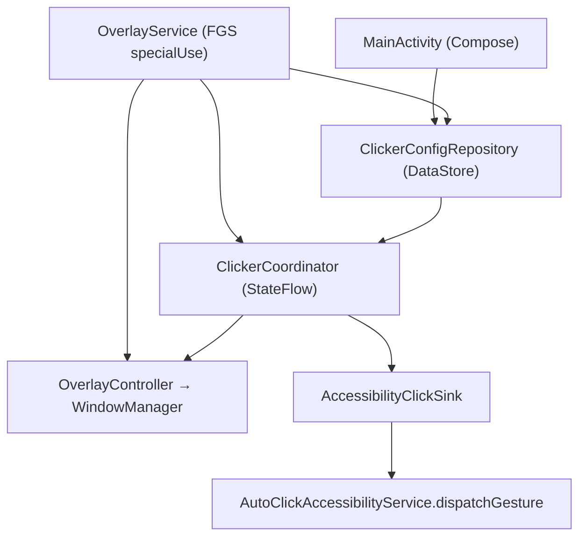

# AutoClick — Technical Reference

**Version 1.2.0** · `com.activebook.autoclick.app` · `minSdk 26` / `targetSdk 36` / `compileSdk 36`

Everything an engineer needs to build, change, or debug this app: stack, architecture, the timing
engine, the overlay windows, permission plumbing, persistence, build and verification.

Product behaviour and copy live in [`DESIGN.md`](DESIGN.md). The chronological history — including
every approach that was measured and rejected — is in [`PLAN.md`](PLAN.md).

---

## 1. Stack

| Item | Version / choice | Why this, not "latest" |
|---|---|---|
| Kotlin | **2.2.21** | Compose compiler plugin is bundled with Kotlin 2.x |
| AGP | **8.13.0** | Newer AndroidX AARs (core 1.19.x, Compose BOM 2026.x) declare `compileSdk 37` + AGP 9.1 and *fail* against 8.13 — versions here are the newest set that actually resolves |
| Gradle | **8.14.3** (wrapper) | Matches the cached distribution |
| compileSdk / targetSdk | **36** / **36** | Android 16 behavior, incl. `specialUse` FGS |
| minSdk | **26** | Floor for `TYPE_APPLICATION_OVERLAY` and for a modern `dispatchGesture` baseline |
| UI | Jetpack Compose, **BOM 2025.06.01**, Material 3 | One design system for activities *and* overlay windows |
| core-ktx / activity-compose / lifecycle | **1.16.0** / **1.10.1** / **2.9.1** | Pinned to the resolvable set (see AGP row) |
| DataStore (preferences) | **1.1.7** | Seven scalar keys; no DB needed |
| Coroutines | **1.10.2** | `StateFlow` + `Flow` plumbing |
| Tests | JUnit 4.13.2, `kotlinx-coroutines-test` | Domain is pure Kotlin, so no Robolectric on the gate |
| DI | Manual `AppContainer` | Five collaborators; Hilt's annotation processing is not worth it |
| Release | R8 (`isMinifyEnabled = true`) | Shrinks to ~1.2 MB; the accessibility deep link is verified to survive R8 |
| Network | **No `INTERNET` permission in the manifest** | Not a promise, an absence |

Toolchain: JDK 17+ (verified with Temurin 21), Android SDK platform 36, `build-tools;36.0.0`,
`local.properties` → `sdk.dir=/Users/mac/Library/Android/sdk`.

---

## 2. Architecture

### 2.1 Shape

```
MainActivity ─┐
              ├── AppContainer (process-wide singletons, manual DI)
OverlayService┘        │
   │                   ├── ClickerConfigRepository   DataStore: cell, interval, toggles, bubble x/y
   ├── OverlayController ── WindowManager: hand / panel / crosshair (Compose + one Canvas View)
   │
AutoClickAccessibilityService ── AccessibilityClickSink ── dispatchGesture()
                                       │
                              ClickerCoordinator   the only component that decides *when* to tap
```

One process, zero IPC. The three ports the engine needs — `Ticker`, `ClickSink`,
`DisplayProvider` — plus `OverlayGuard` are injected, so the whole engine runs under JVM unit tests
with fakes.



### 2.2 Package layout

```
com.activebook.autoclick.app
├── domain/        pure Kotlin, no android.* except value types
│   ├── model/     ClickerConfig, ClickerState, TapOutcome, FailureReason
│   ├── geometry/  GridGeometry (cell → centre), ScreenPoint/ScreenRect
│   └── timing/    IntervalMath (anchor + rebase policy)
├── core/          Contracts (Ticker/ClickSink/DisplayProvider/OverlayGuard), ClickerCoordinator
├── data/          ClickerConfigRepository
├── platform/      Permissions (detection + intents)
├── service/
│   ├── accessibility/  AutoClickAccessibilityService, AccessibilityClickSink
│   ├── overlay/        OverlayController, OverlayLifecycleOwner, CrosshairView
│   └── OverlayService.kt
├── ui/            MainActivity, MainScreen, PermissionSnapshot, FailureMessages, theme, components
│   ├── overlay/   OverlayContent (BubbleContent, PanelContent, SettingsPanel, PanelMode)
│   └── grid/      GridPickerActivity
└── AppContainer.kt, AutoClickApplication.kt
```

Rule: **services contain no scheduling, geometry or formatting logic.** Accuracy-critical code lives
in `domain/` and is unit-tested without a device.

---

## 3. The engine

### 3.1 State

```kotlin
sealed interface ClickerState {
    data object Idle
    data class Running(paused: Boolean, tapCount: Long, skippedTicks: Long, …)
    data class Error(reason: FailureReason)
}
```

`FailureReason ∈ {NO_ACCESSIBILITY, NO_OVERLAY_PERMISSION, SERVICE_DISCONNECTED, DISPLAY_UNAVAILABLE,
TARGET_COVERED_BY_BUBBLE}`. Every surface renders from `ClickerCoordinator.state`; there is no second
boolean anywhere in the app.

### 3.2 Timing — anchored, drift-free, burst-free

`IntervalMath.plan(anchor, interval, nextTick, now)`:
- target of tick *n* is `anchor + n·interval` (absolute `SystemClock.uptimeMillis`), scheduled with
  `Handler.postAtTime`, so a late wake-up does not accumulate error.
- if `now − target > interval`, rebase: `anchor = now`, `tick = 1`. Missed ticks are **dropped**,
  never replayed as a burst.
- interval is clamped by `ClickerConfig.of` to `1..3600 s`, so the rebase branch cannot be entered by
  a zero/negative value.

`ClickerCoordinator` adds four correctness guards:

| Guard | Mechanism | Failure it prevents |
|---|---|---|
| One gesture in flight | `AtomicBoolean` CAS before dispatch | Overlapping gestures when the interval is shorter than the round-trip |
| One live session | monotonically increasing `generation`; late callbacks compare their captured generation | A tap landing after Stop |
| Honest skip counter | covered target, in-flight tick and cancelled gesture all increment `skippedTicks` | A silent no-op that looks like a working loop |
| Budget counts deliveries | the counter is incremented in the gesture callback, after `TapResult.DELIVERED` | A skipped or cancelled tick ending the run short of the number the user asked for |

A session with a budget ends in `ClickerState.Finished`: the ticker is stopped, the generation bumped,
and the counters are frozen so the hand can say `DONE` instead of silently reading `OFF`. Lowering the
budget under a session that already spent it ends it immediately, inside `applyConfig`.

Stroke duration is **55 ms** (`TAP_DURATION_MS`), coerced into `20 ms … 60 s` by the sink — long
enough to be a tap, short enough not to read as a long-press.

### 3.3 Geometry

`GridGeometry.cellCenter(index, usableArea)`: thirds of the usable area, centre of the chosen third.
The area is `display bounds − system bar insets`, read from `WindowManager.maximumWindowMetrics`
(API 30+) with `getRealMetrics` as the pre-30 fallback. Coordinates are recomputed **at fire time**;
only `cellIndex` is ever persisted, so rotation, split-screen and resolution changes are correct for
free.

`OverlayGuard`: the controller keeps cached `getLocationOnScreen()` bounds for the hand and the
panel, refreshed on a frame callback, so the ticker can ask "does my own window cover the target?"
without touching a `View` off the main thread.

---

## 4. Accessibility: the only way in

`res/xml/autoclick_accessibility_service.xml`:

```xml
<accessibility-service
    android:accessibilityEventTypes="typeWindowStateChanged"
    android:accessibilityFeedbackType="feedbackGeneric"
    android:canPerformGestures="true"
    android:canRetrieveWindowContent="false"
    android:notificationTimeout="100"
    android:description="@string/accessibility_service_description" />
```

- `canPerformGestures` is what makes `dispatchGesture` legal; `canRetrieveWindowContent="false"`
  is deliberate minimum privilege — AutoClick cannot read the screen even if it wanted to.
- `AccessibilityClickSink` is a thin adapter: stationary `Path` at `(x, y)`, one
  `StrokeDescription`, one `GestureResultCallback` → `TapResult.DELIVERED / CANCELLED`. It is
  idempotent per call (`AtomicBoolean`), runs on the main looper, and reports `false` when the system
  refuses a second concurrent gesture.
- Service lifecycle maps to the engine: `onServiceConnected` publishes its sink, `onUnbind` /
  `onDestroy` withdraw it, and the next tick fails fast with `SERVICE_DISCONNECTED` instead of
  spamming exceptions.
- **A disconnect is a state, not a tombstone.** The system unbinds and rebinds this service on its
  own schedule — a reinstall, a permission toggle, some ROMs every few seconds. Two invariants keep
  that survivable: an instance withdraws *only its own* sink (`sinkReference.compareAndSet`), so the
  late `onDestroy` of an old instance cannot null the sink a newer one just published; and any
  attach clears a pending `SERVICE_DISCONNECTED` error, because the condition it names is over.
  Measured on the test device, a rebind cycle used to leave the banner `The accessibility service
  disconnected. Re-enable it to keep tapping.` on screen for the life of the process while
  `settings get secure enabled_accessibility_services` still listed the service and no *Enable*
  button was shown.

Component name (the value used by the deep link):

```
com.activebook.autoclick.app/com.activebook.autoclick.app.service.accessibility.AutoClickAccessibilityService
```

---

## 5. Overlay windows

Three windows, never more. Every `WindowManager` call happens on the main thread.

| Window | Size | Type | Flags | Notes |
|---|---|---|---|---|
| Hand | 56 dp × 56 dp | `TYPE_APPLICATION_OVERLAY` | `NOT_FOCUSABLE`, `NOT_TOUCH_MODAL`, `LAYOUT_IN_SCREEN`, `HARDWARE_ACCELERATED` | `NOT_FOCUSABLE` is mandatory: otherwise it steals the IME and the back key |
| Panel | 212 dp × `WRAP_CONTENT` | `TYPE_APPLICATION_OVERLAY` | same four | Created only while expanded; `WRAP_CONTENT` height means any layout change moves the anchor |
| Crosshair | 30 dp × 30 dp | `TYPE_APPLICATION_OVERLAY` | `NOT_FOCUSABLE`, `NOT_TOUCHABLE`, `LAYOUT_IN_SCREEN` | `NOT_TOUCHABLE` is what keeps a decorative marker from eating taps |

All are `PixelFormat.TRANSLUCENT`, `gravity = TOP|START`, and clamped into the usable area
(`edgeMarginPx = 12 dp`). No `FLAG_DIM_BEHIND` and no `FLAG_WATCH_OUTSIDE_TOUCH` — the panel closes
from its own chevron, and a dim scrim was explicitly rejected by the product owner.

The hand also carries a **countdown ring** (1.6.0): a Compose `Canvas` arc at the disc perimeter,
animated 0 → 1 over one interval by an `Animatable`. It is reset by a `mutableLongStateOf` tap
counter that `OverlayController` increments on every `coordinator.tapEvents` emission — the *same*
delivered-tap signal that drives the crosshair flash — so the ring completes exactly as the next tap
lands instead of drifting on a separate timer. It renders only while `Running && !paused`, and
re-times when the interval changes mid-run. See DESIGN §4.4.

### 5.1 Compose inside a raw window

Each window is a `ComposeView` with an `OverlayLifecycleOwner` implementing `LifecycleOwner`,
`ViewModelStoreOwner` and `SavedStateRegistryOwner`
(`SavedStateRegistryController.performRestore(null)` + lifecycle events wired to the view attach
state). Without that, `LaunchedEffect`/`remember` inside the overlay would never start or would leak.

### 5.2 Drag math

`pointerInteropFilter` handles `MotionEvent` directly and uses `rawX/rawY` — true screen coordinates.
Window-local coordinates shift *because the code is moving the window under the finger*, which
produces a feedback loop (measured before the fix: 0.67× travel with ±40 px jitter).

```
params.x = dragAnchorWindowX + (rawX − dragDownScreenX)
params.y = dragAnchorWindowY + (rawY − dragDownScreenY)
```

`ACTION_UP` commits the final pointer position (coalesced MOVE events can drop the last sample) and
then snaps to the nearer edge over **140 ms**. Panel follows the hand at most every **48 ms** while
dragging, so the main thread is not saturated and the tail of the motion stream is not dropped.

### 5.3 Panel anchoring

The panel is `WRAP_CONTENT` in height, so a mode swap (controls ≈ 312 px ⇄ settings ≈ 894 px at 3.0
density) resizes the window *downward from a fixed `y`* unless the anchor is recomputed.

| Trigger | Implementation |
|---|---|
| Any measured height change | `View.OnLayoutChangeListener` on the panel view → `refinePanelPosition()` + `updateBoundsNow()`. This is the only signal ordered *after* Compose measure |
| Placement | `computePanelPosition()` uses the **measured** height when present; the 108 dp estimate is used only before the first measure |
| Drag in flight | throttled `refreshPanelPlacement()` (48 ms) |
| Edge-snap end | `refreshPanelPlacement()` + `refinePanelPosition()` after committing the new `x` |
| Mode swap | Explicitly **does not** reposition — one owner for the anchor, the listener |

Measured on device: 24 px (8 dp) horizontal gap, 0 px vertical centre delta, across controls,
settings, drag-with-settings-open and 10 alternating mode swaps. The only non-zero case is the hand
at the screen bottom, where the 894 px page is clamped — physically unavoidable.

---

## 6. Foreground service

`OverlayService`, `foregroundServiceType="specialUse"` with
`PROPERTY_SPECIAL_USE_FGS_SUBTYPE` describing the overlay + timer, `stopWithTask="false"`, and
`ACTION_*` commands consumed in `onStartCommand`:

| Action | Effect |
|---|---|
| `ACTION_START` | Attach the bubble if permission allows, refresh guard bounds, `coordinator.start()` |
| `ACTION_STOP` | `coordinator.stop()` |
| `ACTION_SHOW` / `ACTION_HIDE` | Attach / release the bubble; `SHOW` without overlay permission calls `stopSelf()` rather than claiming a hand it cannot draw |
| `null` (system restart) | Re-attach the bubble if the permission is held |

- Notification: channel `autoclick_status` (low importance), id `4711`, one contextual action
  (`Stop`/`Start`, `REQUEST_TOGGLE = 10`), content intent `REQUEST_OPEN = 11`.
- **Headless mode**: with Accessibility granted but overlay not, the service runs the loop and the
  notification and simply has no bubble. This is what makes "Start" honest when only one of the two
  permissions is on.
- **Screen policy**: a receiver for `ACTION_SCREEN_OFF` → `coordinator.pause()`, `ACTION_USER_PRESENT`
  → `resume()`. No wakelock, so a locked phone never taps and never drains.
- Bubble lifecycle is a runtime attach/detach (`attachBubble()` is idempotent, `releaseBubble()`), because
  the bubble's existence is decided by the permission, not by a stored preference.

---

## 7. Persistence

`ClickerConfigRepository` over DataStore Preferences — ten keys, all scalar:

| Key | Type | Default |
|---|---|---|
| `cell_index` | Int | `4` (center) |
| `target_mode` | String (`CELL` / `POINT`) | `CELL` |
| `target_x` / `target_y` | Float `0..1` | `0.5` |
| `interval_ms` | Long | `1000` |
| `stop_after_taps` | Int | `0` (no budget) |
| `haptic_on_tap` | Boolean | `true` |
| `flash_on_tap` | Boolean | `true` |
| `bubble_x` / `bubble_y` | Int | last drag position |

Every read funnels through `ClickerConfig.of(...)`, which clamps cell into `0..8`, interval into
`1..3600 s`, the tap budget into `0..100 000` and the exact point into `0..1` on both axes — a
corrupted or hand-edited preference file cannot produce a zero interval, a negative budget or a
target outside the screen. An unknown `target_mode` string falls back to `CELL`, so a store written
by 1.3.0 (three missing keys) behaves exactly as it did before. **No pixel coordinate is stored**:
a point is a *fraction* of the usable area, resolved into pixels on every tick. That is what makes
it survive rotation, a resolution change and a taller status bar. Two processes never write concurrently: the service writes bubble
position, the activity writes config, both through the same repository instance.

---

## 8. Permissions plumbing

| Check | API |
|---|---|
| Overlay | `Settings.canDrawOverlays(context)` |
| Accessibility | `ACCESSIBILITY_ENABLED == 1` in `Settings.Secure`, and `ENABLED_ACCESSIBILITY_SERVICES` contains our `package/class` component |
| Notifications | `NotificationManagerCompat.areNotificationsEnabled()` (33+: runtime grant) |
| Battery | `PowerManager.isIgnoringBatteryOptimizations(package)` |

`PermissionSnapshot` re-reads all four every second while the app is in the foreground, so returning
from a system screen updates rows, badge and card position without a manual refresh.

### 8.1 Opening the accessibility screen **on our row**

The documented per-service API, `ACTION_ACCESSIBILITY_DETAILS_SETTINGS` +
`EXTRA_COMPONENT_NAME`, is gated by `android.permission.OPEN_ACCESSIBILITY_DETAILS_SETTINGS`
(`signature|installer` on the reference ROM) — `SecurityException` for third-party apps, including
`uid=2000`. What ordinary apps do, byte for byte (confirmed by disassembling a shipping app):

```kotlin
val key = ComponentName(context, AutoClickAccessibilityService::class.java).flattenToString()
val args = Bundle().apply { putString(":settings:fragment_args_key", key) }
startActivity(Intent(Settings.ACTION_ACCESSIBILITY_SETTINGS).apply {
    putExtra(":settings:fragment_args_key", key)     // flat copy
    putExtra(":settings:show_fragment_args", args)   // the copy Settings actually reads
})
```

Three traps, all measured:

1. The value must be the **fully qualified** `package/class` string — the short `package/.Class`
   form does not match the preference key.
2. The *flat* `putExtra` alone is ignored; `AccessibilitySettings` reads `getArguments()`, so the key
   must travel inside the Bundle too.
3. No extra flags are needed (`FLAG_ACTIVITY_NEW_TASK` is added only because the caller may be a
   service context).

`Permissions.openAccessibilitySettings()` returns `AccessibilityRoute.HIGHLIGHTED` or `.LIST`, so
callers know whether the scroll was requested. On a ROM that ignores the arguments the code degrades
to the plain list plus the fallback Toast.

### 8.2 The hand-off notice: a Toast, not a window

When our activity is backgrounded behind Settings, an `TYPE_APPLICATION_OVERLAY` window is force-hidden
by the accessibility screen (`mForceHideNonSystemOverlayWindow=true`, set through
`PRIVATE_FLAG_FORCE_HIDE_NON_SYSTEM_OVERLAY_WINDOWS`). Window dumps show `isVisible=false`,
`Surface: shown=false` — the window exists and is invisible, which is why "the window is in the list"
is not evidence of anything.

A text Toast is drawn by the system UI process in its own window (`ty=TOAST`), so the flag does not
apply. The usual Android 11+ restriction on background Toasts is lifted by the `SYSTEM_ALERT_WINDOW`
exemption this app already holds.

Implementation: `MainActivity.openAccessibility()` arms `pendingHint` with a 4 s deadline;
`onStop()` (our activity gone, Settings owns the screen) shows line 1 and posts line 2 after
`HANDOFF_SECOND_LINE_DELAY_MS = 2400`; `onResume()` clears `handoffActive` so a user who is already
back never gets the second line over our own screen.

Measured: Settings foreground at 0.5 s; Toast #1 `[60,132][1020,334]` visible 1.1–4.9 s; Toast #2
`[119,132][961,300]` visible 5.1–8.8 s. The row is highlighted around 2.5 s, so both lines bracket
the whole hand-off.

---

## 9. Build, versioning, artifacts

```bash
./gradlew :app:testDebugUnitTest   # 56 tests
./gradlew :app:lintDebug           # 0 errors
./gradlew :app:assembleDebug       # debug APK  (+ refresh dist/AutoClick-<version>-debug.apk)
./gradlew :app:assembleRelease     # R8 release  (+ refresh dist/AutoClick-<version>.apk)
```

- `versionCode = 3`, `versionName = "1.2.0"`. A name bump without a code bump is refused by the
  project's own invariant.
- Gradle's artifact keeps AGP's canonical name `app-<variant>.apk` because Studio's Run,
  `installDebug` and most CI scripts resolve exactly that path; renaming inside `build/` is only
  reachable through `VariantOutputImpl`, an internal AGP class.
- `dist/AutoClick-<versionName>[-debug].apk` is a byte-identical copy produced by
  `distDebugApk` / `distReleaseApk` `Copy` tasks, attached with `finalizedBy` to every assemble, so a
  stale copy cannot survive. Task lookup uses `tasks.configureEach` (AGP registers the assemble tasks
  after the module script is evaluated).
- Release signing: `keystore.properties` in the repo root (`storeFile`, `storePassword`, `keyAlias`,
  `keyPassword`) if present; otherwise the debug key, which keeps the APK installable for personal
  testing and lets `adb install -r` upgrade over a debug build in place.
- R8 keeps the deep-link path working (verified on the release build, not only on debug).

---

## 10. Tests and verification

### 10.1 Automated

| Gate | Result |
|---|---|
| `:app:testDebugUnitTest` | **56 tests, 0 failures** across `GridGeometryTest`, `IntervalMathTest`, `ClickerConfigTest`, `ClickerCoordinatorTest`, `RelativePointTest`, `TapTargetTest` |
| `:app:lintDebug` | **0 errors, 0 hints**; 14 warnings — dependency-version notices and the battery-exemption policy note |

What the unit tests actually pin: cell centres sit at 1/6, 3/6, 5/6 of the usable area; insets
and degenerate areas produce no NaN; 1000 ticks at a fixed interval equal `anchor + n·interval`;
a single over-long stall produces exactly one rebase and no burst; config clamping rejects zero and
out-of-range values; a late gesture callback after `stop()` cannot increment `tapCount`; a
disconnected sink surfaces as `Error`, not a crash.

### 10.2 On device (vivo V2353A, Android 14, 1080×2408 @ 480 dpi)

| Claim | Evidence |
|---|---|
| Service bound with the right capability | `dumpsys accessibility` → `AutoClick taps, capabilities=32` |
| Loop holds its rate | `51 taps delivered · 0 skipped` at 1 s |
| Tap physically lands in the chosen cell | cell 9 → the stock calculator's `+` key lit up |
| Stop is final | stop, clear, 3 s → display unchanged, counters frozen |
| Coordinates come from the display | crosshair frame `(495,1213)(90×90)` → centre `(540,1258)` = cell-5 centre |
| Guard works | hand over target → `bubble covers target`, `15 taps delivered · 8 skipped` |
| Rotation re-solves the grid | landscape crosshair centre `(2022,918)` |
| Drag is 1:1 | finger Δ −608 px → window Δ −608 px; with panel open 516 → 516 |
| Panel stays beside the hand | 24 px gap / 0 px centre delta across mode swaps, drags, 10 cycles |
| Live edits apply | cell 1→6, 1 s→3 s while running; all surfaces read `Every 3s` |
| Persistence | cell, interval and hand position survive `install -r` and process death |

### 10.3 Debugging on an OEM that hides logcat

This OEM drops the app's own `Log.d`, so on-device behaviour is pinned with `dumpsys` and
`uiautomator` rather than logcat. A temporary file-trace helper was used while developing the
accessibility hand-off and has since been removed; release builds are not debuggable, so `run-as`
is unavailable there by design.

Useful dumpsys fields, in order of usefulness:

```bash
adb shell dumpsys window windows | grep -E "Window #|frame=|isVisible=|mPolicyVisibility=|mForceHide"
adb shell dumpsys activity activities | grep topResumedActivity
adb shell uiautomator dump /sdcard/ui.xml     # real bounds, instead of guessing from a screenshot
adb shell dumpsys accessibility | grep -E "Bound services|capabilities"
```

---

## 11. Decision record (ADR index)

| ADR | Decision | Status |
|---|---|---|
| 001 | Taps via `AccessibilityService.dispatchGesture`, never root/adb/reflection | Accepted |
| 002 | One FGS + one AccessibilityService + process-singleton coordinator; single process | Accepted |
| 003 | Compose for app *and* overlay, hosted by `ComposeView` + `OverlayLifecycleOwner` | Accepted |
| 004 | DataStore Preferences for scalar keys (seven in 1.3.0, ten in 1.4.0) | Accepted |
| 019 | Tap budget counted in delivered taps, surfaced as its own `Finished` state | Accepted — `Idle` would make a completed run look like a never-started one |
| 005 | Store a cell index, resolve pixels at fire time from current metrics | Accepted |
| 006 | Anchored `HandlerThread` scheduling, rebase on over-long stalls, no `AlarmManager` | Accepted |
| 007 | Never swallow own taps — **replaced**: refuse at start, skip at runtime (no window-flag dance) | Superseded by PLAN §15.2 |
| 008 | Sideload distribution, zero network, minimum privileges, no Play Store | Accepted |
| 009 | Settings live inside the overlay panel, not a separate activity | Accepted (supersedes part of 002) |
| 010 | Bubble is translucent glass, no shadow, no dim scrim | Accepted |
| 011 | Nine-grid in the app is a 132 dp indicator; aiming happens in a full-screen picker | Accepted |
| 012 | Accessibility list opened with `:settings:fragment_args_key` + Bundle copy | Accepted |
| 013 | `dist/AutoClick-<version>.apk` naming, canonical Gradle artifact untouched | Accepted |
| 014 | The tap loop must not depend on the bubble (headless mode) | Accepted |
| 015 | A permission switch is a remote control for its system screen, never a fake toggle | Accepted |
| 016 | The hand's existence is the overlay permission, not a preference | Accepted |
| 017 | Hand-off notice as an overlay window | **Superseded** — force-hidden on that screen |
| 018 | Hand-off notice as two text Toasts | Accepted |
| 020 | Countdown ring driven by delivered-tap events (`tapEvents`), not a separate timer | Accepted — a second timer would drift out of step with the real taps |

---

## 12. Known constraints and risks

| Constraint | Consequence | Mitigation in place |
|---|---|---|
| Accessibility is user-granted and OEM-revocable | A reinstall unbinds the service; some ROMs unbind on `force-stop` | Honest `n of 4` badge, orange CTA, one-line fix sentences |
| Android 13+ sideload blocks the toggle | Switch appears greyed out | `Greyed out? App info › Allow restricted settings.` shown while Accessibility is off |
| A reinstall can reset overlay + notifications on some ROMs | Hand missing after an update for a reason unrelated to the service | The checklist reports the truth; nothing is auto-flipped |
| Accessibility screens force-hide app overlays | No custom notice can be drawn there | System Toasts (ADR-018) |
| Aggressive ROM killers | FGS may be killed in long soaks | Battery row, ongoing notification, state reconciliation on resume |
| No root / no shell by policy | No silent permission granting | Deliberate: the app stays installable and usable by a normal user |
| Play Store policy | Accessibility-based tapping is not distributable there | Sideloaded APK, documented |

---

## 13. Repo map

```
auto-click/
├─ app/src/main/java/com/activebook/autoclick/app/   domain / core / data / platform / service / ui
├─ app/src/test/java/...                             6 test classes, 56 JVM tests
├─ app/src/main/res/                                 strings (English), themes, icons, XML configs
├─ dist/                                             AutoClick-1.2.0.apk and -debug.apk (copies)
├─ docs/DESIGN.md                                    product + interaction design
├─ docs/TECH.md                                      this file
├─ docs/PLAN.md                                      requirements, ADRs, round-by-round history
├─ docs/CI.md                                        CI/CD plan (gates, release automation, signing)
├─ gradle/libs.versions.toml                         pinned, build-verified versions
└─ README.md                                         what the app is, for a person browsing GitHub
```
